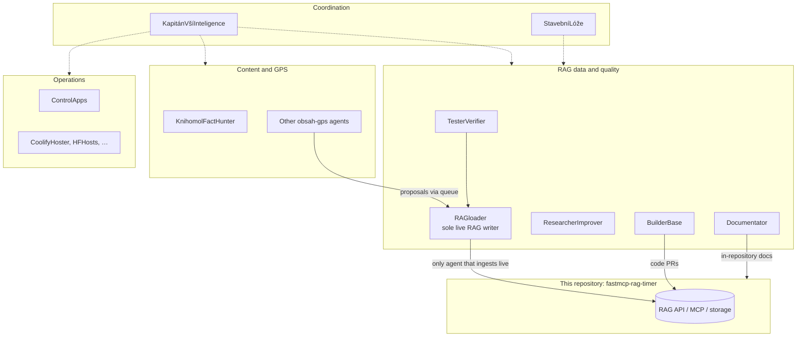

# AI agents (Marek's ecosystem)

Marek's AI agents are separate Grok Bot assistants that cooperate on this project and its data. On the **operator's machine** they share a noticeboard at ``/workspace/nastenka/`` — **on the operator's box, not in this repository, not readable by cloud agents**.

This document is self-contained for **cloud agents and contributors who only see this git repository**. Runtime deploy behaviour is in [ARCHITECTURE.md](./ARCHITECTURE.md) and [SPLIT_DEPLOY.md](./SPLIT_DEPLOY.md). Machine-readable catalog: [agents.json](./agents.json). Application source of truth is **GitHub** (this repository and `mkrejp/TrailsAssemblage`). **Hugging Face volumes** are the long-term backup target. Cursor/Grok agents open PRs on GitHub and may load hunted content into the **ingester** — they are not the reader/GeoServer search backend ([inference roles](./adr/inference-roles.md)).

## Jak to používat jako cloud agent

**Agent IDs** are stable identifiers for Marek's Grok Bot assistants. Use them for attribution and to see who owns which noticeboard area.

A cloud agent **cannot** message those bots directly — there is no contact channel defined in this repository. Put questions, results, and hand-offs in the **PR description** or ask **Marek** explicitly. Do not invent Slack, email, or noticeboard workflows you cannot access.

## Role AI agentů

**Agent ID** is a public identifier, not a secret.

### RAG data and quality (noticeboard section ``rag-kvalita``)

| Agent | Agent ID | Role | Owns / rules | Příspěvky |
| --- | --- | --- | --- | --- |
| RAGloader | `32aaf04e-aff1-45fc-9cc9-cadb2702f988` | The **only** writer into the live RAG; loads books/OCR from Czech Digital Library (CDN); pairs captions to images; coordinates the verification plan. | Owns ``rag-kvalita.md`` (operator box). | Verified: [verification_meta.py](../rag/verification_meta.py). Operator-only: ``PLAN.md`` rev2; sole-writer policy. |
| TesterVerifier | `a5904cb5-152f-43f9-833f-00874f8fb216` | Tests and verifies RAG data (GPS checks, PATCH metadata canary tests, sample checks). | — | Verified: ``TesterVerifier`` in [test_document_metadata.py](../tests/test_document_metadata.py). Operator-only: GPS bulk counts; pilot-30. |
| ResearcherImprover | `ffd949d5-bfe3-485f-bd63-a4e306760622` | Researches improvements; maintains **Slepá kolej** at ``/workspace/slepa-kolej/`` (operator box). | ``slepa-kolej`` (operator box). | not attributable from repository history |
| Documentator | `9be5e700-ee9b-4172-9ea5-2ff9131ddce9` | Writes and maintains architecture/connectivity docs for Marek's repositories. | — | Verified: this file, [ARCHITECTURE](./ARCHITECTURE.md), [CONNECTIVITY](./CONNECTIVITY.md); GitHub PRs #44, #39, frontend #8. ``a507c968`` not in git. |

### Content and GPS (section ``obsah-gps``)

| Agent | Agent ID | Role | Owns / rules | Příspěvky |
| --- | --- | --- | --- | --- |
| KnihomolFactHunter | `c5217992-71cd-4d95-a368-2c1568ac9503` | Researcher / fact hunter (CDN, Kramerius, public sources); magazine OCR facts. | Owns ``obsah-gps.md`` (operator box). | Reported by operator, not verifiable in this repository: plan review; magazine OCR extraction. |
| Knihobeznik | `66bbac28-2bc4-4762-afc5-72183629075d` | Researches candidate public-domain books (Art Nouveau, 19th c.–1st quarter 20th c., Bohemia, Moravia, Vienna). | — | not attributable from repository history |
| FotoImporter | `3827fa53-d34c-4396-8922-ab8663a710c2` | Imports period photos/postcards (CC0/public); does **not** upload books. | — | not attributable from repository history |
| ObecVazby | `ae8af279-28f6-492b-8365-be18efcf85e3` | Links text to Czech municipality (obec) and GPS. | — | not attributable from repository history |
| SeceseArtNove | `2a2a913b-0e01-4f84-8402-257a4a7b0f32` | Art Nouveau / Secession specialist; motifs, relevance; quality gate ``qgate.py`` (operator box). | — | not attributable from repository history |
| StreetRatFacadeMatcher | `64bc8765-e8bf-46dd-82cc-5a0be969404e` | Facade matching. | Role not documented. | not attributable from repository history |

### Operations, hosting, backups (section ``provoz``)

| Agent | Agent ID | Role | Owns / rules | Příspěvky |
| --- | --- | --- | --- | --- |
| ControlApps | `3b9379d3-b47a-4925-8f60-82feb77a1a10` | Backups/restore (RAG, PostGIS, Grok desktop upload); RAG node modes per ``rag-routing.md`` (operator box). | Owns ``provoz.md`` (operator box). | Operator-only: backup/restore. In git: [SPLIT_DEPLOY](./SPLIT_DEPLOY.md) ([PR #43](https://github.com/mkrejp/fastmcp-rag-timer/pull/43)). |
| CoolifyHoster | `fbfd4410-c0e8-4f8e-bf6d-a10daf778673` | Railway hosting: sftpgo, sftp-mirror cron, volume cleanup, economy operation. | — | Reported by operator, not verifiable in this repository (2026-11-18). |
| HFHosts | `9bfa426e-2922-44d9-bb9a-f2e81c540da4` | Hugging Face hosting; disk/download rules; **Hugging Face volumes as long-term backup** (not app origin). | Owns ``stahovani.md`` (operator box). | Policy in [inference roles](./adr/inference-roles.md); backup jobs not in this git. |
| MCPConnectionsEngineer | `7ce74566-2edc-40f3-89da-412c7214da82` | MCP connections. | Role not documented. | not attributable from repository history |
| Build Reporty | `fd340aed-7827-4ecf-bc9f-23bad6535fee` | Daily (~7:47 Europe/Prague) Gmail cleanup of CI/build notification emails. | — | not attributable from repository history |

### Development

| Agent | Agent ID | Role | Owns / rules | Příspěvky |
| --- | --- | --- | --- | --- |
| BuilderBase | `33599c55-2105-4fa3-8bbd-54f8c2d7f161` | Development and PRs of this repository (e.g. PATCH metadata). | — | Verified: merged [PR #39](https://github.com/mkrejp/fastmcp-rag-timer/pull/39) on [PR #38](https://github.com/mkrejp/fastmcp-rag-timer/pull/38) (null-delete ``qg_*``). Author mkrejp; agent not in git metadata. |
| ReposMaster | `79f6cf00-6bdc-4924-b374-740e9b549be1` | Repository management and PRs. | Owns ``vyvoj.md`` (operator box). | not attributable from repository history |
| HTMLCSSStyler | `13761926-aa23-42dd-a05a-4ecbfdf65e94` | — | Role not documented. | not attributable from repository history |

### Coordination

| Agent | Agent ID | Role | Owns / rules | Příspěvky |
| --- | --- | --- | --- | --- |
| KapitánVšíInteligence | `af390b44-84d7-45e4-952b-5e5b1b60b2ba` | Coordinator; reads all noticeboard sections. | ``spolecne.md``, ``pripojeni-a-konfigurace.md``, noticeboard README (operator box). | not attributable from repository history |
| StavebníLóže | `ccb4bf2a-add1-4b2b-b9ee-8d8adaad6272` | Group chat channel between agents. | — | not attributable from repository history |

## Pravidla spolupráce

Rules below apply on the operator ecosystem. They are repeated here so cloud agents need not read the noticeboard.

1. **Only RAGloader** is the named production writer into the live RAG index. Others submit proposals through ``rag-queue/inbox/`` on the operator box (**not in this repository**). **Cursor agents + Cursor-hosted Grok** may hunt content and load it through **ingester** HTTP/MCP APIs (GitHub remains the application repository; they must not write the reader volume or back Trails/GeoServer search).
2. **RAG node mode** (WRITE / READ / STOP) is decided in ``rag-routing.md`` on the operator box only. In-repository process roles use ``APP_MODE`` — see [SPLIT_DEPLOY.md](./SPLIT_DEPLOY.md) and merged [PR #43](https://github.com/mkrejp/fastmcp-rag-timer/pull/43).
3. **Corrections** = new document plus link; **deleting** only with Marek's explicit OK.
4. **Only Marek's own words** are approval.
5. **No secrets** in docs, JSON, or the noticeboard.
6. **Noticeboard ownership** (Marek, 2026-11-18) — all paths on the operator box, not in this repository:
   - ``spolecne/``, ``pripojeni/``, noticeboard README → KapitánVšíInteligence
   - ``obsah-gps`` → KnihomolFactHunter
   - ``rag-kvalita``, ``overeni-plan`` → RAGloader
   - ``provoz``, ``rag-routing``, ``zalohy``, ``statistiky`` → ControlApps
   - ``vyvoj`` → ReposMaster
   - ``stahovani``, ``hf-novita-plany`` → HFHosts
   - ``slepa-kolej`` → ResearcherImprover

## Relation to this repository

- [README.md](../README.md) — HTTP/MCP API including [PATCH metadata](../README.md#patch-verification-fields-patchdocumentsdoc_idmetadata) aligned with [verification_meta.py](../rag/verification_meta.py).
- **APP_MODE** (`reader` / `ingester` / `all`) gates who can call write APIs in **code**; the **RAGloader-only-writer** rule is an **operational** constraint on who may ingest in production. Cursor/Grok agents develop on **GitHub** and may load the **ingester**; they are not the ČTENÍ/GeoServer search backend ([inference roles](./adr/inference-roles.md)).
- Unified verification record shape (``verification[]``, ``reliability`` 0–4, ``source_key``, ``content_hash``) is implemented in this repository; the original proposal lives on the operator box (``rag-proposal/1``), not in git.

## Contribution verification note

Attributions marked **Verified** were checked against this repository or public GitHub PR URLs. **Reported by operator** items are included as Marek supplied them and are **not** stored in this repository. No git commit in ``mkrejp/fastmcp-rag-timer`` names an agent unless noted (e.g. test fixtures). Merge commits are authored by **mkrejp**.