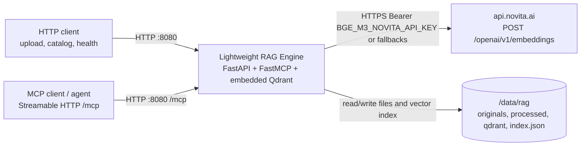
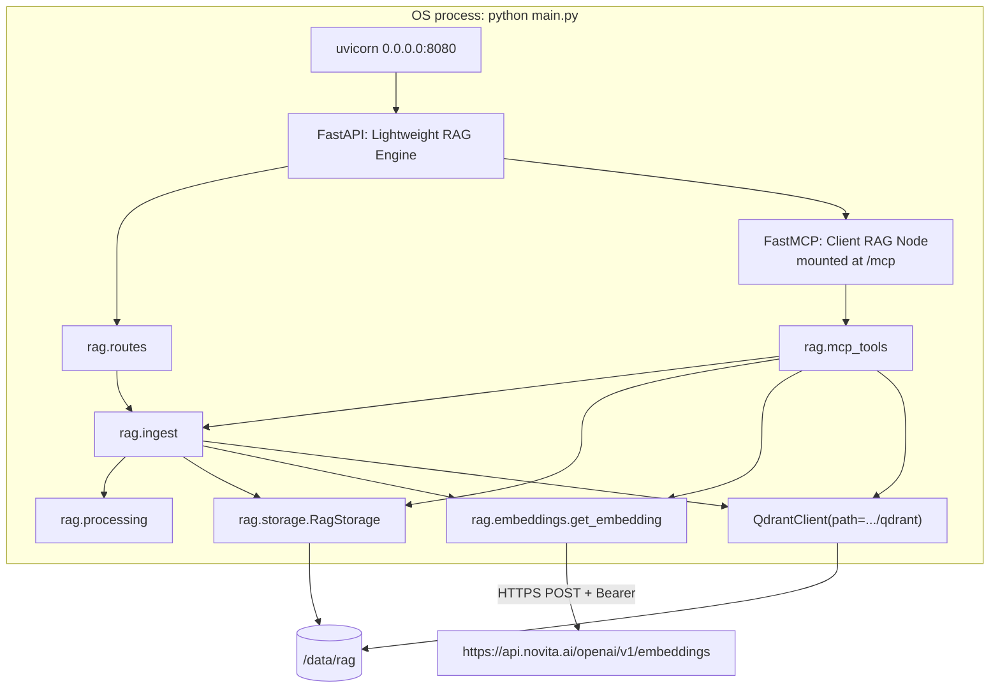
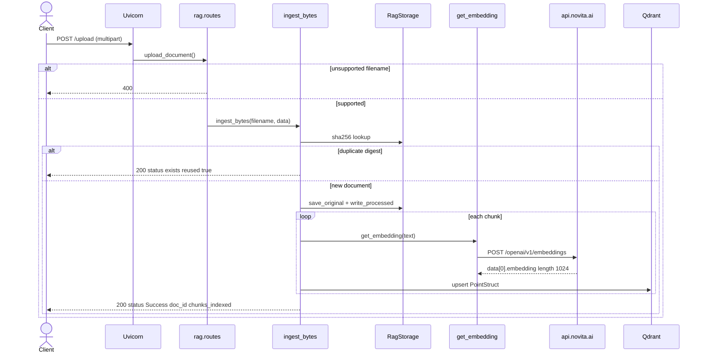
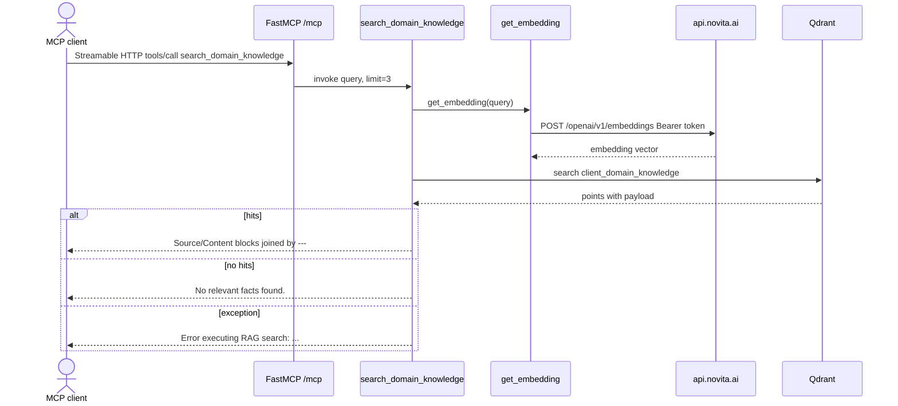

# Architecture

## Purpose and scope

This document describes **fastmcp-rag-timer** as implemented in this repository.

The service is a single-process Python application that:

- Accepts PDF, TXT, and Markdown uploads over HTTP (FastAPI) and optional plain-text ingest over MCP.
- Persists originals and processed fulltext/chunks under a data root (default `/data/rag`).
- Embeds chunks with Novita `baai/bge-m3` and indexes them in an embedded Qdrant collection.
- Exposes catalog/text HTTP APIs and Streamable HTTP MCP tools (including similarity search) from the same uvicorn process.

**Sources of truth:** `main.py`, `rag/` (`app.py`, `config.py`, `embeddings.py`, `ingest.py`, `mcp_tools.py`, `processing.py`, `routes.py`, `storage.py`, `vectorstore.py`), `Dockerfile`, `README.md`, `docs/embedding-provider.md`, and `tests/`. There is no `pyproject.toml`, `requirements.txt`, lockfile, compose file, CI config, or platform config (for example `railway.toml`).

Statements below are taken from those files unless labeled **Assumption**.

Embedding request details (endpoint, auth, timeouts, privacy, cost) live in [Embedding connectivity](./CONNECTIVITY.md#embedding-connectivity) and [Embedding provider](./embedding-provider.md).

## System context



**Assumption:** An HTTPS edge (Railway or similar reverse proxy) sits in front of port 8080 in production. Nothing in the repo terminates TLS. README says to mount a Railway volume at `/data`; there is no Railway config file in the repo.

## Component and module overview

```text
main.py                 # uvicorn entrypoint; module-level app = create_app()
rag/
  app.py                # FastAPI factory, FastMCP mount, shared storage + Qdrant
  routes.py             # HTTP API
  mcp_tools.py          # FastMCP tools
  storage.py            # originals + processed + index.json
  processing.py         # PDF/text extract + chunk
  embeddings.py         # Novita BGE-M3 client
  ingest.py             # persist + embed + upsert pipeline
  vectorstore.py        # local Qdrant open/create
  config.py             # constants and RAG_DATA_ROOT
```

| Component | Where | Role |
| --- | --- | --- |
| FastAPI app `Lightweight RAG Engine` | `rag.app.create_app()` | HTTP API (see [HTTP API](#http-api)). FastAPI also exposes default `/docs`, `/redoc`, `/openapi.json` (not disabled). |
| FastMCP server `Client RAG Node` | `rag.app.create_app()` | `stateless_http=True`, `streamable_http_path="/"`, mounted at `/mcp` with the MCP app lifespan entered from FastAPI. |
| `get_embedding()` | `rag/embeddings.py` | `POST https://api.novita.ai/openai/v1/embeddings` with model `baai/bge-m3`. |
| `RagStorage` | `rag/storage.py` | Filesystem catalog under `RAG_DATA_ROOT`. |
| Embedded Qdrant | `rag/vectorstore.py` | `QdrantClient(path=storage.qdrant_dir)`, collection `client_domain_knowledge`, cosine, size `1024`. |
| Uvicorn | `main.py` `__main__` and Docker `CMD` | `host=HOST` (`0.0.0.0`), `port=PORT` (`8080`). |
| Tests | `tests/` | pytest; `RAG_SKIP_DEFAULT_APP=1` so `main.py` does not lock the production Qdrant path. |
| Container image | `Dockerfile` | Python 3.11 slim, `uv` installer, `mcp[cli]<2`, `EXPOSE 8080`, `ENV RAG_DATA_ROOT=/data/rag`. No `VOLUME` instruction. |



`mcp` and FastAPI share one process, one `RagStorage`, and one Qdrant client created in `create_app()`. There is no separate database container. Qdrant is opened once at app construction so uvicorn does not take the local-path lock twice (`main.py` comment).

## HTTP API

From `rag/routes.py`:

| Method | Path | Behavior |
| --- | --- | --- |
| `GET` | `/health` | `{"status": "ok", "rag_data_root": ...}` |
| `POST` | `/upload` | PDF, TXT, or Markdown → persist + index |
| `POST` | `/upload-pdf` | PDF-only alias |
| `POST` | `/upload-media` | Store bytes under `originals/{uuid}/`; **not** extracted or indexed |
| `GET` | `/documents` | Catalog from `index.json` |
| `GET` | `/documents/{doc_id}` | Metadata |
| `GET` | `/documents/{doc_id}/text` | Processed full text from disk (no re-parse, no embedding call) |

There is **no REST search** endpoint. Similarity search is MCP-only (`search_domain_knowledge`). There is no HTTP delete/reindex route. `RagStorage.remove_document_files` exists for tests/cleanup and does not delete Qdrant points.

## Exposed MCP tools, resources, and prompts

From `rag/mcp_tools.py`, registered in `create_app()` and served at **`/mcp`** (Streamable HTTP). `streamable_http_path="/"` so the MCP endpoint is the mount root `/mcp`, not `/mcp/mcp`.

| Kind | Name | Present? |
| --- | --- | --- |
| Tool | `list_documents() -> str` | Yes |
| Tool | `get_document_text(doc_id: str) -> str` | Yes |
| Tool | `get_document_chunks(doc_id: str) -> str` | Yes |
| Tool | `ingest_text(filename: str, content: str) -> str` | Yes |
| Tool | `search_domain_knowledge(query: str, limit: int = 3) -> str` | Yes |
| Resource | — | None |
| Prompt | — | None |

Tool behavior:

- `list_documents`: JSON of `storage.list_documents()`, or `"No documents stored."`
- `get_document_text` / `get_document_chunks`: disk reads of processed artifacts; missing id returns a not-found string
- `ingest_text`: if the filename is not a supported suffix, appends `.txt`; calls `ingest_bytes`; returns JSON or `"Error ingesting text: ..."`
- `search_domain_knowledge`: embed query → `qdrant.search` → format `Source: {source} (doc_id=...)` + `Content:`; empty → `"No relevant facts found."`; exceptions → `"Error executing RAG search: ..."`

No stdio MCP entrypoint (`mcp.run()` is not called). Tests assert that `/mcp` is mounted; they do not exercise a live MCP session handshake.

## RAG pipeline

There is **retrieval + embedding**, not generation. No chat/completions call exists. See [Embedding connectivity](./CONNECTIVITY.md#embedding-connectivity).

### Ingestion

Shared path: `rag.ingest.ingest_bytes` (HTTP `/upload`, `/upload-pdf`, and MCP `ingest_text`).

1. Require a filename; reject unsupported types (`ValueError` → HTTP 400 on REST).
2. SHA-256 the bytes. If `skip_duplicate` (default true) and the digest is already in the catalog, return `status: exists` with `reused: true` and **do not** re-embed.
3. Allocate `doc_id = uuid4()`.
4. `save_original`: write under `originals/{doc_id}/{Path(filename).name}` (basename only).
5. `process_document`: extract + chunk (~1000 characters, page-aware for PDFs).
6. Write `processed/{doc_id}/fulltext.txt`, `chunks.json`, `meta.json`; upsert `index.json`.
7. For each chunk, `get_embedding(text)` and `qdrant.upsert` a `PointStruct`.
8. Point id: `uuid5(NAMESPACE_URL, f"{doc_id}:{chunk_index}")`.
9. Payload: `text`, `source` (filename), `doc_id`, `page`, `chunk_index`.

Supported types (`rag/processing.py`): `.pdf`; `.txt`, `.md`, `.markdown`, `.text`. PDFs use `pypdf.PdfReader` over in-memory bytes. Text is decoded as utf-8, utf-8-sig, then latin-1, then utf-8 with replacement.

Chunking: page segments are concatenated until over `DEFAULT_CHUNK_SIZE` (1000 characters); oversize segments are sliced at 1000 chars. No overlap, no token counting. Each chunk stores the page index of the segment currently being accumulated. Empty extractable text yields zero chunks and no upsert (HTTP still `status: Success`).

`POST /upload-media` assigns a new `doc_id`, saves the original, and returns path + id. It does not call `ingest_bytes`.

### Embeddings

See [Embedding connectivity](./CONNECTIVITY.md#embedding-connectivity). Collection size `1024` matches `EMBEDDING_DIM` / `baai/bge-m3`. Missing credentials raise `ValueError` naming `BGE_M3_NOVITA_API_KEY`. HTTP `_ingest_upload` maps any `ValueError` to **400** (filename/type checks and missing credentials). Other embedding failures (`HTTPError`, JSON errors, unexpected dimension) become HTTP **500** `"Ingest failed: ..."`. MCP search and ingest tools catch exceptions and return error strings.

### Vector store

- `QdrantClient(path=str(storage.qdrant_dir))` — embedded on-disk, not a remote Qdrant URL.
- Default directory: `{RAG_DATA_ROOT}/qdrant` → `/data/rag/qdrant` in the image.
- Collection name (hardcoded): `client_domain_knowledge`.
- Created in `open_qdrant()` if missing. If the existing collection’s vector size is not `EMBEDDING_DIM` (1024), that collection is **deleted and recreated** (vectors in it are lost; files on disk are not). See [Embedding provider](./embedding-provider.md).
- In-memory mode (`:memory:`) is not used.

### Retrieval

Only `search_domain_knowledge`: embed query → cosine search with `limit` (default 3) → concatenate payload text. No metadata filters, no rerank, no hybrid/keyword search. Citations are `source` plus `doc_id` when present.

### Timer / scheduling

**None.** There is no scheduler, cron, background task, or interval job. The repository name includes `timer`; that behavior is not implemented.

Dockerfile installs `curl` (comment: healthchecks). `GET /health` exists. There is no Docker `HEALTHCHECK` instruction.

## Runtime and request flow

Startup (`python main.py` or Docker `CMD`):

1. Unless `RAG_SKIP_DEFAULT_APP=1`, `main.py` calls `create_app()`.
2. Resolve `RAG_DATA_ROOT` (default `/data/rag`; Dockerfile sets the same).
3. `RagStorage.ensure_layout()` creates `originals/`, `processed/`, `qdrant/`, and empty `index.json`.
4. Open embedded Qdrant; create or recreate the collection if needed.
5. Build FastMCP, register tools, `mcp.streamable_http_app()`, FastAPI lifespan enters the MCP app’s lifespan.
6. Include HTTP router; `app.mount("/mcp", mcp_app)`.
7. Uvicorn binds `0.0.0.0:8080`.

`uvicorn main:app` uses the module-level `app` so Qdrant is not opened a second time.

### HTTP: document ingest



### Typical MCP call



`list_documents`, `get_document_text`, and `get_document_chunks` do not call the embedding API; they only read disk.

## Configuration and environment variables

| Name | Default / value | Used for |
| --- | --- | --- |
| `RAG_DATA_ROOT` | `/data/rag` (`DEFAULT_RAG_DATA_ROOT`; Dockerfile `ENV`) | Originals, processed artifacts, Qdrant, `index.json` |
| `BGE_M3_NOVITA_API_KEY` | unset | Preferred Bearer token for embeddings |
| `NOVITA_API_KEY` | unset | Embedding credential if `BGE_M3_NOVITA_API_KEY` is empty |
| `OPENAI_TOKEN` | unset | Embedding credential if both Novita-named vars are empty |
| `OPENAI_API_KEY` | unset | Embedding credential checked last |
| `RAG_SKIP_DEFAULT_APP` | unset; tests set `"1"` | Skip module-level `create_app()` in `main.py` |

Not configurable without code changes:

| Item | Value |
| --- | --- |
| HTTP bind | `HOST = "0.0.0.0"`, `PORT = 8080` (not `os.getenv("PORT")`) |
| Collection | `client_domain_knowledge` |
| Vector size / metric | `EMBEDDING_DIM = 1024` / cosine |
| Embed model | `baai/bge-m3` |
| Embed URL | `https://api.novita.ai/openai/v1/embeddings` |
| Embed timeout | 60 seconds |
| Chunk size | `DEFAULT_CHUNK_SIZE = 1000` characters |
| MCP server name | `Client RAG Node` |
| FastAPI title | `Lightweight RAG Engine` |
| MCP mount | `/mcp` |

There is no `.env` file, `.env.example`, or secret manager integration in the repo.

**Assumption:** If deployed on Railway, `BGE_M3_NOVITA_API_KEY` is a service variable, a volume is mounted at `/data`, and public HTTPS is mapped to 8080. Railway often injects `PORT`; this app ignores it and always listens on 8080.

## Build and deployment

`Dockerfile`:

- Base: `python:3.11-slim-bookworm`
- Copies `uv` / `uvx` from `ghcr.io/astral-sh/uv:latest`
- `WORKDIR /app`
- `apt-get install curl`
- `uv pip install --system`: `fastapi`, `uvicorn`, `"mcp[cli]<2"` (comment: FastMCP lives in mcp 1.x; 2.x renames it to MCPServer), `pypdf`, `qdrant-client`, `requests`, `python-multipart`
- `COPY main.py ./` and `COPY rag ./rag`
- `EXPOSE 8080`
- No `VOLUME` instruction (comment: Railway rejects Dockerfile `VOLUME`; use the service volume mount)
- `ENV RAG_DATA_ROOT=/data/rag`
- `CMD ["python", "main.py"]`

No multi-stage build, no non-root user, no image pin for `uv:latest`. Aside from `mcp[cli]<2`, Python packages are unpinned.

Local run (from README):

```bash
export RAG_DATA_ROOT=./data/rag
export BGE_M3_NOVITA_API_KEY=your-novita-key
python main.py
```

Tests (from README):

```bash
pip install pytest pytest-mock 'mcp[cli]<2' fastapi uvicorn pypdf qdrant-client requests python-multipart
pytest -q
```

There is no GitHub Actions (or other) CI workflow in the repo.

**Assumption:** Production is this Docker image on Railway with a volume at `/data` and HTTP routed to 8080.

## Security

| Topic | What the code does |
| --- | --- |
| HTTP auth | None on REST routes or FastAPI docs. |
| MCP auth | None on `/mcp`. |
| Secrets | Embedding key from `BGE_M3_NOVITA_API_KEY`, then `NOVITA_API_KEY`, `OPENAI_TOKEN`, `OPENAI_API_KEY`; sent as `Authorization: Bearer`. Not read from a file or vault. See [Embedding connectivity](./CONNECTIVITY.md#embedding-connectivity). |
| TLS | Not implemented in-app. |
| Upload path | Originals use `Path(filename).name` (directory components stripped). |
| Upload size / type | `/upload` allows PDF/TXT/Markdown suffixes only. `/upload-pdf` requires `.pdf`. `/upload-media` accepts any upload. No size quota in code. |
| Bind address | `0.0.0.0`. |
| Container user | Default root of `python:3.11-slim-bookworm`. |
| Dependency supply chain | Unpinned packages except `mcp[cli]<2`; `uv:latest`. |

Anyone who can reach port 8080 can ingest documents (which triggers paid embedding calls) and read the catalog/fulltext.

## Observability

- No application logger, metrics, tracing, or request IDs in `rag/` or `main.py`.
- Uvicorn default access/error logs only (not configured in code).
- `GET /health` returns liveness + `rag_data_root`; no readiness check of Qdrant or Novita.
- MCP tool failures are returned as strings, not logged.
- Embedding HTTP failures: `raise_for_status()` then JSON parse and dimension check; HTTP ingest → 400 or 500; MCP tools → error string.

## Limitations

Current gaps (not a history of old bugs):

1. **No timer/scheduler** despite the repository name.
2. **No MCP resources or prompts.**
3. **No REST search** — similarity search is MCP-only.
4. **No generator LLM** — retrieval only; no answer synthesis.
5. **No inbound auth**, quotas, or upload size limits.
6. **Hardcoded port 8080** — `PORT` is not read.
7. **`/upload-media`** stores files but does not index them or add them to `index.json`.
8. **No public document delete** (file cleanup would not remove Qdrant points).
9. **No CI workflow** and no lockfile; most Docker deps unpinned.
10. **No Docker HEALTHCHECK** despite `curl` and `/health`.
11. Embeddings are **one HTTP call per chunk/query**, with no batch `input` array, retries, or 429 handling.
12. Recreating a Qdrant collection on dimension mismatch **drops existing vectors**.
