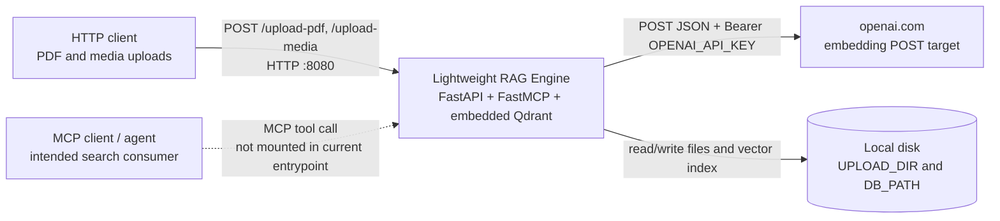
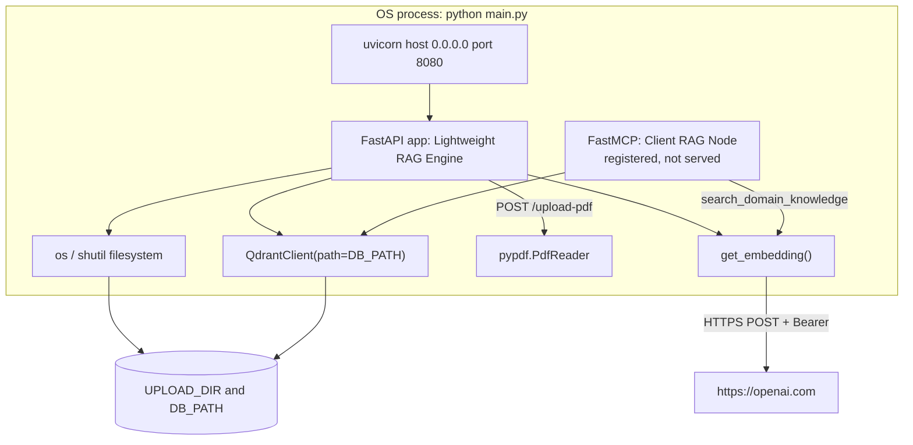
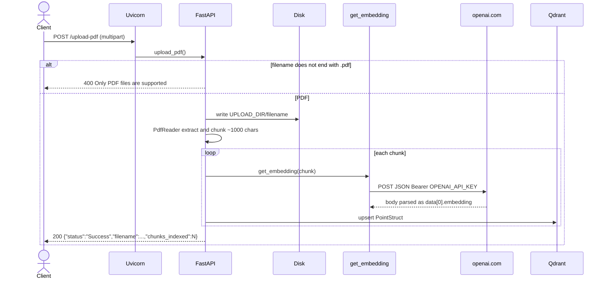
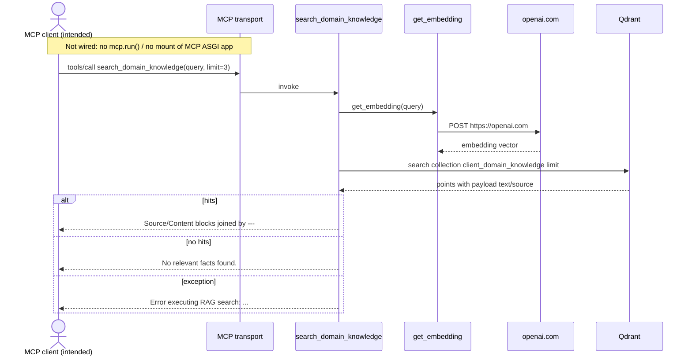

# Architecture

## Purpose and scope

This document describes the architecture of **fastmcp-rag-timer** as implemented in this repository.

The service is a single-process Python application that:

- Accepts PDF and media uploads over HTTP (FastAPI).
- Extracts text from PDFs, chunks it, embeds chunks, and stores vectors in a local Qdrant collection.
- Registers one Model Context Protocol (MCP) tool for similarity search over that collection.

**Sources of truth in this repo:** `main.py`, `Dockerfile`, `README.md`. There is no `pyproject.toml`, `requirements.txt`, lockfile, compose file, CI config, or platform config (for example `railway.toml`).

Statements below are taken from those files unless labeled **Assumption**.

## System context

Actors and systems that touch this process:



**Assumption:** MCP clients / “Client Agents” are the intended search consumers, based on the comment in `main.py` (“Exposed directly to your Client Agents”) and the README. They are not wired in the current process entrypoint (see [Exposed MCP tools, resources, and prompts](#exposed-mcp-tools-resources-and-prompts)).

**Assumption:** An HTTPS edge (Railway or similar reverse proxy) sits in front of port 8080 in production. Nothing in the repo terminates TLS.

## Component and module overview

The running unit is one Python module.

| Component | Where | Role |
| --- | --- | --- |
| FastAPI app `Lightweight RAG Engine` | `app` in `main.py` | HTTP API: `POST /upload-pdf`, `POST /upload-media`. FastAPI also exposes default `/docs`, `/redoc`, and `/openapi.json` unless disabled (they are not disabled here). |
| FastMCP server `Client RAG Node` | `mcp` in `main.py` | Registers `search_domain_knowledge`. Not started or mounted by `uvicorn.run(app, ...)`. |
| `get_embedding()` | `main.py` | `POST` to `https://openai.com` with model `text-embedding-3-small`. |
| Embedded Qdrant | `QdrantClient(path=DB_PATH)` | Local on-disk collection `client_domain_knowledge`, cosine, vector size `1536`. |
| Filesystem | `UPLOAD_DIR`, `DB_PATH` | PDF/media blobs and Qdrant data. |
| Uvicorn | `if __name__ == "__main__"` and Docker `CMD` | Serves **only** the FastAPI `app` on `0.0.0.0:8080`. |
| Container image | `Dockerfile` | Python 3.11 slim, `uv` installer, unpinned pip packages, `EXPOSE 8080`, `VOLUME ["/app/storage"]`. |



`mcp` and `app` share process memory and the same Qdrant client. There is no separate database container.

## Exposed MCP tools, resources, and prompts

From `main.py`:

| Kind | Name | Present? |
| --- | --- | --- |
| Tool | `search_domain_knowledge(query: str, limit: int = 3) -> str` | Yes (`@mcp.tool()`) |
| Resource | — | None |
| Prompt | — | None |

Tool behavior:

1. Embed `query` via `get_embedding()`.
2. `qdrant.search` on `client_domain_knowledge` with `limit` (default 3).
3. Format hits as `Source: {payload.source}\nContent: {payload.text}` joined by `\n---\n`.
4. Empty hits → `"No relevant facts found."`
5. Any exception → `"Error executing RAG search: {str(e)}"` (errors are returned as tool text, not raised).

**Runtime gap:** `__main__` runs `uvicorn.run(app, host="0.0.0.0", port=8080)`. There is no `mcp.run()`, no `app.mount(...)` of `mcp.streamable_http_app()` / `mcp.sse_app()`, and no stdio MCP entrypoint. Docker `CMD` is `python main.py`. The tool is defined in-process but not reachable over MCP transports from the documented start command.

**Assumption:** The intended HTTP transport, if wired later, would be the MCP Python SDK Streamable HTTP app (typically path `/mcp`) or stdio for local agents. That is SDK convention, not code in this repo.

## RAG pipeline

There is **retrieval + embedding**, not generation. No LLM completion call exists. Search is not exposed as a REST route.

### Ingestion

Triggered only by `POST /upload-pdf`:

1. Reject the request with HTTP 400 unless `file.filename` ends with `.pdf`.
2. Write the upload to `os.path.join(UPLOAD_DIR, file.filename)` (original filename, no sanitization).
3. `PdfReader` over that path; `page.extract_text() or ""` for each page.
4. Concatenate page text with newlines into `current_chunk`. When `len(current_chunk) > 1000`, emit a chunk and reset. Remainder becomes a final chunk. No overlap, no token counting, no heading-aware split.
5. For each chunk, call `get_embedding(chunk)` and `qdrant.upsert` a `PointStruct`.
6. Point id: `hash(f"{file.filename}_{idx}") & 0xFFFFFFFFFFFFFFFF`.
7. Payload: `{"text": chunk, "source": file.filename, "page": page_num}`.

`page_num` is the loop variable from `enumerate(reader.pages)` and is **not** reset per chunk. After the loop it is the last page index, so every point for that file stores that last page number.

`POST /upload-media` only copies bytes to `UPLOAD_DIR`. It does not extract, embed, or upsert.

There is no delete, reindex, or list-documents API.

### Embeddings

```text
POST https://openai.com
Authorization: Bearer $OPENAI_API_KEY
Content-Type: application/json
{"input": <text>, "model": "text-embedding-3-small"}
```

Response handling is `res.json()["data"][0]["embedding"]`. There is no timeout, retry, or status-code check.

The Qdrant collection is created with `VectorParams(size=1536, distance=Distance.COSINE)` and a comment `# text-embedding-3-small`, which matches that model’s published dimension.

`OPENAI_API_KEY` is required at call time (`ValueError` if missing). On `/upload-pdf` that exception is unhandled (FastAPI 500). On the MCP tool it is caught and returned as a string.

The code posts to `https://openai.com`, not `https://api.openai.com/v1/embeddings`. **Assumption:** this is incomplete/incorrect wiring rather than a documented OpenAI API. Live embedding calls against that URL are expected to fail or return a non-embeddings body; `res.json()["data"][0]["embedding"]` would then raise.

### Vector store

- Client: `qdrant_client.QdrantClient(path=DB_PATH)` — embedded local storage, not a remote Qdrant server.
- Default `DB_PATH`: `./storage/qdrant` (inside the image that is `/app/storage/qdrant` because `WORKDIR /app`).
- Collection name (hardcoded): `client_domain_knowledge`.
- Created on import if missing. No migration, replica, or snapshot code.

README says “in-memory or local-disk”. The code uses `path=DB_PATH` (on-disk). In-memory mode (`:memory:`) is not used.

Python’s `hash()` on strings is randomized per process unless `PYTHONHASHSEED` is fixed, so point ids are not stable across process restarts. Upserts after restart can create additional points rather than overwrite the same ids.

### Retrieval

Only `search_domain_knowledge`: embed query → cosine search → concatenate payload text. No metadata filters, no rerank, no hybrid/keyword search, no citation beyond `source`.

### Timer / scheduling

**None in this repository.** There is no `asyncio` scheduler, cron, APScheduler, Celery, background task, or interval job. Repo name `fastmcp-rag-timer` and any “timer node” behavior are not implemented.

Dockerfile installs `curl` “for healthchecks”, but there is no `HEALTHCHECK` instruction and no `/health` route.

## Runtime and request flow

Startup (`python main.py` or Docker `CMD`):

1. Read env: `UPLOAD_DIR`, `DB_PATH`, `OPENAI_API_KEY`.
2. `os.makedirs` for upload and DB paths.
3. Construct FastAPI and FastMCP objects.
4. Open embedded Qdrant; create collection if needed.
5. Uvicorn binds `0.0.0.0:8080` and serves FastAPI only.

`main.py` is imported for side effects (directory and collection creation) even if a host later used `uvicorn main:app`.

### HTTP: PDF ingest (implemented)



### HTTP: media store (implemented)

`POST /upload-media` writes `UPLOAD_DIR/filename` and returns `{"status":"Saved","path": file_path}`. No type check.

### Typical MCP call (tool implementation; transport not started)

This is the in-process flow of `search_domain_knowledge`. It is **not** reachable via the current uvicorn entrypoint.



## Configuration and environment variables

All configuration is in `main.py` via `os.getenv` or literals.

| Name | Default / value | Used for |
| --- | --- | --- |
| `UPLOAD_DIR` | `./storage/files` | Upload destination |
| `DB_PATH` | `./storage/qdrant` | Embedded Qdrant path |
| `OPENAI_API_KEY` | unset (`None`) | Bearer token in `get_embedding()`; also assigned to `EMBEDDING_API_KEY` |

Not configurable without code changes:

| Item | Value |
| --- | --- |
| HTTP bind | `0.0.0.0:8080` (not `PORT`) |
| Collection | `client_domain_knowledge` |
| Vector size / metric | `1536` / cosine |
| Embed model | `text-embedding-3-small` |
| Embed URL | `https://openai.com` |
| Chunk threshold | `1000` characters |
| MCP server name | `Client RAG Node` |
| FastAPI title | `Lightweight RAG Engine` |

There is no `.env` file, `.env.example`, or secret manager integration in the repo.

**Assumption:** If deployed on Railway, `OPENAI_API_KEY` would be a service variable, and a volume would be mounted at `/app/storage`. The Dockerfile comment says “Persistent Storage Volume Target for Railway”; no Railway config file exists. Railway often injects `PORT`; this app ignores it and always listens on 8080.

## Build and deployment

`Dockerfile`:

- Base: `python:3.11-slim-bookworm`
- Copies `uv` / `uvx` from `ghcr.io/astral-sh/uv:latest`
- `WORKDIR /app`
- `apt-get install curl` (comment: healthchecks)
- `uv pip install --system` unpinned: `fastapi`, `uvicorn`, `mcp[cli]`, `pypdf`, `qdrant-client`, `requests`, `python-multipart`
- `COPY main.py .` only
- `EXPOSE 8080`
- `VOLUME ["/app/storage"]`
- `CMD ["python", "main.py"]`

No multi-stage build, no non-root user, no image pin for `uv:latest`, no Python dependency pins.

Local run (not documented in README, inferred from `__main__`):

```bash
python main.py
# equivalent: uvicorn main:app --host 0.0.0.0 --port 8080
```

**Assumption:** Production is a Docker image on Railway (or any Docker host) with a volume on `/app/storage` and HTTP routed to 8080.

## Security

| Topic | What the code does |
| --- | --- |
| HTTP auth | None on `/upload-pdf`, `/upload-media`, or FastAPI docs. |
| MCP auth | None (and no MCP listener). |
| Secrets | `OPENAI_API_KEY` from the environment; sent as `Authorization: Bearer`. Not read from a file or vault. |
| TLS | Not implemented in-app. |
| Upload path | Filename is joined onto `UPLOAD_DIR` unchanged (`../` and absolute names are not rejected). |
| Upload size / type | PDF suffix check only on `/upload-pdf`. `/upload-media` accepts any upload. No size quota in code. |
| Bind address | `0.0.0.0` (reachable on all interfaces). |
| Container user | Default root of `python:3.11-slim-bookworm`. |
| Dependency supply chain | Unpinned packages at image build; `uv:latest`. |

## Observability

- No application logger, metrics, tracing, or request IDs in `main.py`.
- Uvicorn default access/error logs only (uvicorn defaults; not configured in code).
- No `/health`, `/ready`, or metrics path.
- MCP tool failures are returned as strings, not logged.
- Embedding HTTP failures surface as exceptions (500 on upload; string on the tool).

## Limitations and future improvements

Observed gaps (code vs name/README):

1. **No timer.** Repo name includes `timer`; no scheduler exists.
2. **MCP is not served.** Tool exists; process entrypoint does not expose it.
3. **No MCP resources or prompts.**
4. **No REST search.** Ingest is HTTP; retrieve is MCP-only (and unwired).
5. **Embedding URL** is `https://openai.com`, not the public OpenAI embeddings API.
6. **Not full RAG.** No generator LLM, prompt assembly, or answer synthesis.
7. **Chunk `page` payload** is the last page index, not the chunk’s page.
8. **Point ids** use `hash()` (process-salted); restarts can duplicate vectors.
9. **No auth, quotas, or filename sanitization.**
10. **No tests, CI, lockfile, or health endpoint.**
11. **Unpinned Docker dependencies.**
12. **Hardcoded port 8080** vs common `PORT` injection.
13. **Media uploads** are stored but never indexed.
14. **No document deletion / update** besides upsert of new hashed ids.

Reasonable follow-ups (not implemented): mount FastMCP on the FastAPI app (or run stdio), point embeddings at `https://api.openai.com/v1/embeddings` (or another provider) with timeouts, add `/health`, bind `PORT`, pin dependencies, authenticate ingest and MCP, sanitize paths, persist stable point ids, fix page metadata, add a timer only if a job is actually required, and generate answers only if this should be more than retrieval.
