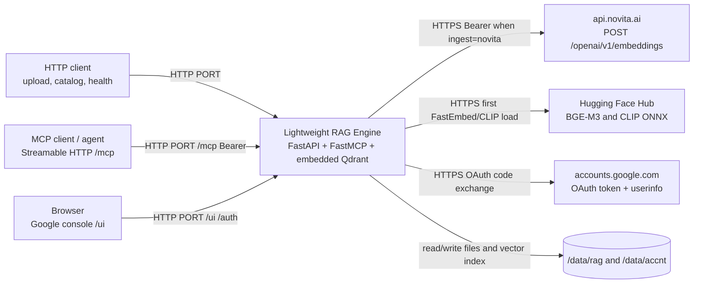
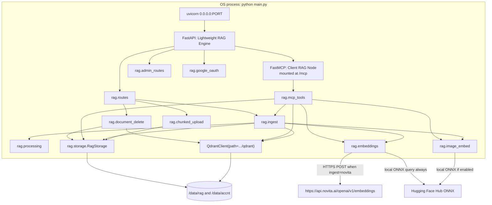
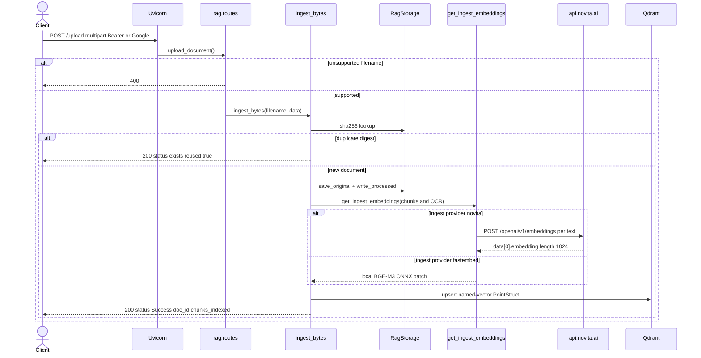
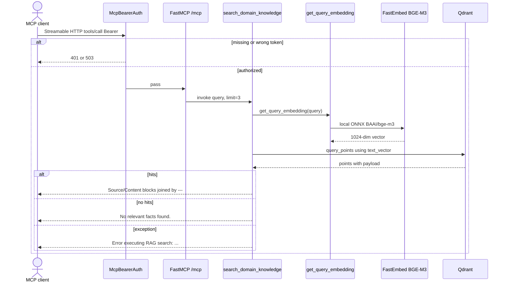

# Architecture

## Purpose and scope

This document describes **fastmcp-rag-timer** as implemented in this repository.

The service is a single-process Python application that:

- Accepts PDF, TXT, Markdown, and JSON/GeoJSON over HTTP (FastAPI), including multipart upload, chunked upload with server-side reassembly, remote GeoJSON by URL via bearer-authenticated `POST /ingest-json`, and optional plain-text ingest over MCP.
- Persists originals, processed fulltext/chunks/images, and chunked-upload staging under a data root (default `/data/rag`).
- Embeds ingest text with Novita `baai/bge-m3` or local FastEmbed `BAAI/bge-m3` (`EMBEDDING_PROVIDER_INGEST`), and embeds **every search query** with local FastEmbed only.
- Indexes named vectors in an embedded Qdrant collection (`text_vector` 1024, `image_vector` 512).
- Exposes catalog/text HTTP APIs, a Google-authenticated console, Streamable HTTP MCP tools (including similarity search), and per-day accounting under `/data/accnt`.

**Sources of truth:** `main.py`, `rag/` (`app.py`, `config.py`, `embeddings.py`, `image_embed.py`, `ingest.py`, `document_delete.py`, `mcp_tools.py`, `processing.py`, `routes.py`, `admin_routes.py`, `google_oauth.py`, `chunked_upload.py`, `asgi_shutdown.py`, `storage.py`, `vectorstore.py`, `auth.py`), `Dockerfile`, `README.md`, `docs/embedding-provider.md`, `static/`, and `tests/`.
`pyproject.toml` lists runtime dependencies (including `fastembed`, `pymupdf`, `pillow`, `pytesseract`).
There is no `requirements.txt`, lockfile, compose file, or platform config (for example `railway.toml`).
CI lives under `.github/workflows/` (Super Linter and Docker image build; pytest is not run in CI).

Statements below are taken from those files unless labeled **Assumption**.

Embedding request details (endpoint, auth, timeouts, privacy, cost) live in [Embedding connectivity](./CONNECTIVITY.md#embedding-connectivity) and [Embedding provider](./embedding-provider.md).

## System context



**Assumption:** An HTTPS edge (Railway or similar reverse proxy) sits in front of the listen port in production. Nothing in the repository terminates TLS. README says to mount a Railway volume at `/data`; there is no Railway config file in the repository.

## Component and module overview

```text
main.py                 # uvicorn entrypoint; module-level app = create_app()
rag/
  app.py                # FastAPI factory, FastMCP mount, UI, Google session, lifespan
  routes.py             # HTTP API
  admin_routes.py       # /api/admin (Google session)
  google_oauth.py       # /auth/*
  mcp_tools.py          # FastMCP tools
  chunked_upload.py     # uploads/{upload_id} staging
  asgi_shutdown.py      # complete MCP SSE responses on shutdown
  storage.py            # originals + processed + index.json
  processing.py         # PDF/text/GeoJSON extract + chunk
  pdf_images.py         # PyMuPDF embedded image extraction
  ocr.py                # local Tesseract OCR
  geojson.py            # generic GeoJSON → RAG text
  remote.py             # fetch remote JSON (GitHub blob → raw)
  auth.py               # inbound bearer for /ingest-json, /mcp, embedding REST
  embeddings.py         # Novita HTTP ingest and/or local FastEmbed BGE-M3
  image_embed.py        # local CLIP for image_vector
  ingest.py             # persist + embed + upsert pipeline
  geo_refined.py        # geo_refined Pydantic schema and prefer-refined helpers
  geo_index.py          # refine_geo / refine_geo_batch persistence
  document_delete.py    # remove one document from disk + Qdrant
  vectorstore.py        # local Qdrant open/create named vectors
  accounting.py         # /data/accnt rollups
  logging_setup.py      # rag logger + ring buffer
  config.py             # constants and env helpers
static/                 # RAG console
```

| Component | Where | Role |
| --- | --- | --- |
| FastAPI app `Lightweight RAG Engine` | `rag.app.create_app()` | HTTP API (see [HTTP API](#http-api)). FastAPI also exposes default `/docs`, `/redoc`, `/openapi.json` (not disabled). |
| FastMCP server `Client RAG Node` | `rag.app.create_app()` | `stateless_http=True`, `streamable_http_path="/"`, mounted at `/mcp` behind `McpBearerAuth` and `CompleteResponseOnExit`. FastAPI lifespan enters the MCP app lifespan and closes Qdrant on shutdown. |
| RAG console | `static/` + `google_oauth.py` + `admin_routes.py` | Google-gated UI at `/ui/`; admin JSON under `/api/admin`. |
| `get_ingest_embeddings()` / `get_query_embedding()` | `rag/embeddings.py` | Ingest: Novita `baai/bge-m3` or FastEmbed `BAAI/bge-m3`. Query: FastEmbed only. Startup calls `validate_embedding_configuration()`. |
| CLIP `embed_image_paths` / `embed_image_query` | `rag/image_embed.py` | Optional `image_vector` (512-dim) when `IMAGE_EMBEDDING_ENABLED=true`. |
| `RagStorage` | `rag/storage.py` | Filesystem catalog under `RAG_DATA_ROOT`. |
| `ChunkedUploadStore` | `rag/chunked_upload.py` | Staging under `{RAG_DATA_ROOT}/uploads`. |
| Embedded Qdrant | `rag/vectorstore.py` | `QdrantClient(path=storage.qdrant_dir)`, collection `client_domain_knowledge`, cosine, named vectors `text_vector` (1024) and `image_vector` (512). |
| Uvicorn | `main.py` `__main__` and Docker `CMD` | `host=HOST` (`0.0.0.0`), `port=PORT` (`os.getenv("PORT", "8080")`), `proxy_headers=True`, `timeout_graceful_shutdown=15`. |
| Tests | `tests/` | pytest; `RAG_SKIP_DEFAULT_APP=1` so `main.py` does not lock the production Qdrant path. |
| Container image | `Dockerfile` | Python 3.11 slim, `uv` installer, `mcp[cli]<2`, Tesseract `ces+eng`, `EXPOSE 8080`, `ENV RAG_DATA_ROOT=/data/rag`. No `VOLUME` instruction. |



`mcp` and FastAPI share one process, one `RagStorage`, one `ChunkedUploadStore`, one accounting store, and one Qdrant client created in `create_app()`. There is no separate database container. Qdrant is opened once at app construction so uvicorn does not take the local-path lock twice (`main.py` comment). Lifespan closes the Qdrant client on shutdown.

## HTTP API

From `rag/routes.py`, `rag/app.py`, `rag/google_oauth.py`, and `rag/admin_routes.py`:

| Method | Path | Auth | Behavior |
| --- | --- | --- | --- |
| `GET` | `/health` | None | `status`, `rag_data_root`, `embeddings` (ingest/query providers), `image_embedding_enabled` |
| `POST` | `/upload` | Bearer MCP/RAG or Google | PDF, TXT, Markdown, JSON, or GeoJSON → persist + index |
| `POST` | `/upload/init` | same as `/upload` | Start chunked session; returns `upload_id`, `chunk_size`, `chunk_count`, `expires_at` |
| `PUT` | `/upload/{upload_id}/chunks/{index}` | same | Store one raw chunk; idempotent for identical bytes; optional `X-Chunk-SHA256` |
| `GET` | `/upload/{upload_id}` | same | Progress (`received_indexes`, `bytes_received`, `complete`) |
| `POST` | `/upload/{upload_id}/complete` | same | Verify whole-file SHA-256, assemble, ingest, delete staging |
| `DELETE` | `/upload/{upload_id}` | same | Abort staging; `204` or `404` |
| `POST` | `/upload-pdf` | same as `/upload` | PDF-only alias |
| `POST` | `/upload-media` | **None** | Store bytes under `originals/{uuid}/`; **not** extracted or indexed |
| `POST` | `/ingest-json` | Bearer `RAG_API_TOKEN` | Body `{"url": "..."}`; fetch remote GeoJSON/JSON and index feature attributes (coordinates skipped) |
| `GET` | `/documents` | **None** | Catalog from `index.json` |
| `GET` | `/documents/{doc_id}` | **None** | Metadata |
| `GET` | `/documents/{doc_id}/text` | **None** | Processed full text from disk (no re-parse, no embedding call) |
| `DELETE` | `/documents/{doc_id}` | same as `/upload` | Remove files (including `images/`), catalog row, and Qdrant points. `200` `{"status":"deleted","doc_id","filename","chunks_removed"}`; `404` if missing; `401`/`503` if unauthorized |
| `GET` | `/images/{doc_id}/{image_id}` | same as `/upload` | Extracted PDF image bytes; `413` if larger than 50 MiB |
| `GET` | `/` | None | Redirect to `/ui/` |
| `GET` | `/ui/` | Google session | RAG console; redirects to `/auth/login` if unsigned-in, or `?error=not_configured` if OAuth env is missing |
| `GET` | `/auth/*` | mixed | Google OAuth login, callback, logout, `/auth/me` (session), `/auth/status` (public) |
| `GET` | `/api/admin/status` | Google session | Service, volume sizes, MCP tools, embedding providers, Qdrant stats |
| `GET` | `/api/admin/documents` | Google session | Catalog with disk sizes |
| `GET` | `/api/admin/documents/{doc_id}` | Google session | Metadata, text/chunk previews |
| `GET` | `/api/admin/volume` | Google session | Top-level data-root listing |
| `GET` | `/api/admin/mcp` | Google session | MCP mount + tool descriptions |
| `GET` | `/api/admin/logs` | Google session | In-memory log ring buffer |
| `GET` | `/api/admin/accounts` | Google session | Daily accounting rollups |
| `GET` | `/api/admin/accounts/{date}` | Google session | One UTC day; optional `include_events` |

Chunked-upload errors: `400` validation, `404` unknown session, `409` chunk conflict, `410` expired.

There is **no REST search** endpoint. Similarity search is MCP-only (`search_domain_knowledge`, `search_images`). There is no HTTP reindex route. `rag.document_delete.delete_document` deletes Qdrant points by `payload.doc_id` then calls `RagStorage.remove_document_files`.

## Exposed MCP tools, resources, and prompts

From `rag/mcp_tools.py`, registered in `create_app()` and served at **`/mcp`** (Streamable HTTP). `streamable_http_path="/"` so the MCP endpoint is the mount root `/mcp`, not `/mcp/mcp`. Every `/mcp` HTTP request requires Bearer `MCP_API_TOKEN` or fallback `RAG_API_TOKEN` (`McpBearerAuth`; 401 invalid, 503 unset).

| Kind | Name | Present? |
| --- | --- | --- |
| Tool | `list_documents(since: str = "") -> str` | Yes |
| Tool | `get_document_text(doc_id: str) -> str` | Yes |
| Tool | `get_document_chunks(doc_id: str) -> str` | Yes |
| Tool | `get_document_images(doc_id: str) -> str` | Yes |
| Tool | `get_image(image_id: str) -> list[TextContent \| ImageContent]` | Yes |
| Tool | `ingest_text(filename: str, content: str) -> str` | Yes |
| Tool | `search_domain_knowledge(query: str, limit: int = 3, obec_id: str = "", cast_obce: str = "") -> str` | Yes |
| Tool | `search_images(query: str, limit: int = 5, hybrid: bool = False) -> str` | Yes |
| Tool | `sync_links_to_trails(dry_run: bool = False) -> str` | Yes |
| Tool | `refine_geo(doc_id, geo_refined, chunk_index?, image_id?, dry_run=true) -> str` | Yes |
| Tool | `refine_geo_batch(items, dry_run=true) -> str` | Yes |
| Tool | `list_geo_refinements(filter?, …) -> str` | Yes |
| Resource | — | None |
| Prompt | — | None |

Tool behavior:

- `list_documents`: JSON of `storage.list_documents(since=)`, or `"No documents stored."` when the catalog is empty and `since` is omitted. `since` is an ISO-8601 timestamp compared inclusively to `uploaded_at`.
- `get_document_text` / `get_document_chunks`: disk reads of processed artifacts; missing ID returns a not-found string
- `get_document_images`: JSON of `DocumentMeta.images` plus optional public URL from `PUBLIC_BASE_URL`
- `get_image`: inline MCP image up to 5 MiB; larger files return a fetch hint (`PUBLIC_BASE_URL/images/...` or a relative path)
- `ingest_text`: if the filename is not a supported suffix, appends `.txt`; calls `ingest_bytes`; returns JSON or `"Error ingesting text: ..."`
- `search_domain_knowledge`: `get_query_embedding` (FastEmbed) → `search_similar` on `text_vector` with optional `obec_id` / `cast_obce` payload filter on denormalized `localities` / `cast_obce` arrays → format `Source:` / `Content:` blocks (OCR image hits included when they have text vectors); empty → `"No relevant facts found."`; exceptions → `"Error executing RAG search: ..."`
- `search_images`: requires `IMAGE_EMBEDDING_ENABLED=true`; CLIP text tower → `image_vector`; `hybrid=true` RRF-merges CLIP hits with `pdf_image` text hits
- `link_locality` / `verify_link`: when `TRAILS_API_URL` and `TRAILS_API_TOKEN` are set, forward to TrailsAssemblage `POST /locality-links` and `PATCH /locality-links/{id}/verify`. Failures retry with backoff then land in `{RAG_DATA_ROOT}/trails_outbox.json`; MCP tools still succeed. Unset env leaves tools unchanged.
- `sync_links_to_trails`: idempotent backfill of all `locality_links` points; `dry_run` counts without HTTP.
- `refine_geo`: validates a `geo_refined` object (Pydantic) and `set_payload`s it onto document metadata and/or Qdrant image/chunk points. Never writes original `lat`/`lon`. `dry_run=true` (default) returns old vs new. Repeat writes of the same object are idempotent; a changed object is appended to `geo_refined_history`. Same `/mcp` bearer as `link_locality`. Not forwarded to Trails.
- `refine_geo_batch`: pages of ≤200 `{doc_id, chunk_index?, image_id?, geo_refined}` items; per-item `ok` / `would_change` / `changed` / `error`. One invalid item does not abort the rest. Whole-call error if empty or oversize.
- `list_geo_refinements`: scroll Qdrant + document catalog for stored `geo_refined`; filter precision/status/confidence_level/needs_refinement/verified/doc_id; `limit`/`offset` pagination.

No stdio MCP entrypoint (`mcp.run()` is not called). Tests post JSON-RPC `initialize` / `tools/list` to `/mcp/`.

## RAG pipeline

There is **retrieval + embedding**, not generation. No chat/completions call exists. See [Embedding connectivity](./CONNECTIVITY.md#embedding-connectivity).

### Ingestion

Shared path: `rag.ingest.ingest_bytes` (HTTP `/upload`, `/upload-pdf`, chunked `/upload/{id}/complete`, `/ingest-json`, and MCP `ingest_text`).

1. Require a filename; reject unsupported types (`ValueError` → HTTP 400 on REST).
2. SHA-256 the bytes. If `skip_duplicate` (default true) and the digest is already in the catalog, return `status: exists` with `reused: true` and **do not** re-embed.
3. Allocate `doc_id = uuid4()`.
4. `save_original`: write under `originals/{doc_id}/{Path(filename).name}` (basename only).
5. `process_document`: extract + chunk (~1000 characters, page-aware for PDFs).
6. For PDFs: extract embedded images (skip smaller than 64×64 px or 4 KiB), OCR, write under `processed/{doc_id}/images/`.
7. Write `processed/{doc_id}/fulltext.txt`, `chunks.json`, `meta.json`; upsert `index.json`.
8. Embed chunk texts and OCR summaries with `get_ingest_embeddings` (Novita: one HTTP POST per string; FastEmbed: batched ONNX).
9. Optional CLIP vision vectors when `IMAGE_EMBEDDING_ENABLED=true`.
10. Upsert named-vector `PointStruct`s. Chunk point id: `uuid5(NAMESPACE_URL, f"{doc_id}:{chunk_index}")`. Image point id: `uuid5(NAMESPACE_URL, f"{doc_id}:img:{image_id}")`.
11. Chunk payload: `source_type=pdf_chunk`, `text`/`content_summary`, `source`/`parent_document`, `doc_id`, `page_number`, `chunk_index`, `sha256`, optional `source_url`. Image payload: `source_type=pdf_image` plus `image_id`, `file_path`, `page_number`.

Supported types (`rag/processing.py`): `.pdf`; `.txt`, `.md`, `.markdown`, `.text`; `.json`, `.geojson`. PDFs use `pypdf.PdfReader` over in-memory bytes. Text is decoded as utf-8, utf-8-sig, then latin-1, then utf-8 with replacement. JSON/GeoJSON is turned into per-feature text records via `rag.geojson` (attributes only; coordinate rings are omitted).

Chunking: page segments are concatenated until over `DEFAULT_CHUNK_SIZE` (1000 characters); oversize segments are sliced at 1000 chars. No overlap, no token counting. Each chunk stores the page index of the segment currently being accumulated. Empty extractable text yields zero chunks and no upsert (HTTP still `status: Success`).

`POST /upload-media` assigns a new `doc_id`, saves the original, and returns path + ID. It does not call `ingest_bytes` and does not add a catalog row.

Chunked upload (`POST /upload/init` … `complete`) stages parts under `{RAG_DATA_ROOT}/uploads/{upload_id}/`, verifies the client-supplied whole-file SHA-256 on complete, then calls the same `ingest_bytes` path.

### Embeddings

See [Embedding connectivity](./CONNECTIVITY.md#embedding-connectivity) and [Embedding provider](./embedding-provider.md).

- Text collection size is always BGE-M3 **1024** (`text_vector`). CLIP `image_vector` is **512**.
- Query embeddings always use local FastEmbed. `EMBEDDING_PROVIDER_QUERY=novita` (including an unset default of `novita` without override) **refuses to start**.
- Missing Novita credentials on a Novita ingest call raise `ValueError` naming `BGE_M3_NOVITA_API_KEY`.
- FastEmbed needs no API key; first use downloads ~2.3GB ONNX.
- HTTP `_ingest_upload` maps any `ValueError` to **400** (filename/type checks and missing credentials).
- Other ingest failures become HTTP **500** `"Ingest failed: ..."`.
- MCP search and ingest tools catch exceptions and return error strings.

### Vector store

- `QdrantClient(path=str(storage.qdrant_dir))` — embedded on-disk, not a remote Qdrant URL.
- Default directory: `{RAG_DATA_ROOT}/qdrant` → `/data/rag/qdrant` in the image.
- Collection name (hardcoded): `client_domain_knowledge`.
- Named vectors: `text_vector` (1024, cosine) and `image_vector` (512, cosine). Payload indexes on `source_type`, `doc_id`, `chunk_sha256`, `localities`, `cast_obce`, `image_id`, and nested `geo_refined.{precision,status,confidence_level,needs_refinement,verified}`. New ingests store empty `localities` / `cast_obce` arrays and `chunk_sha256` (hash of chunk text). Existing points are backfilled with `set_payload` only (no re-embed, no delete). `link_locality` denormalizes `obec_id` / `cast_obce` onto matching knowledge points. Optional `geo_refined` is written the same way (no collection recreate, no migration).
- Created in `open_qdrant()` if missing. Unnamed single-vector collections, or a marker/`embedding_backend.json` whose schema/dimensions do not match, are **deleted and recreated** (vectors in it are lost; files on disk are not). Switching ingest provider (`novita` ↔ `fastembed`) at 1024-dim BGE-M3 does **not** recreate. Toggling `IMAGE_EMBEDDING_ENABLED` does not recreate.
- In-memory mode (`:memory:`) is not used.

### Retrieval

- `search_domain_knowledge`: FastEmbed query → cosine search on `text_vector` with `limit` (default 3). Optional `obec_id` / `cast_obce` filters on payload arrays. Hits may be PDF chunks or OCR image points. Citations use `parent_document`/`source`, `source_type`, `doc_id`, optional `page_number` / `image_id` / URL. When coordinates exist, JSON hits include preferred `lat`/`lon`, `geo_source` (`refined` if `geo_refined` is present else `original`), `geo_original`, and `geo_refined`.
- `search_images`: CLIP query → `image_vector` (default limit 5); optional hybrid RRF with OCR text hits. Optional `precision` / `needs_refinement` filters on `geo_refined`. Disabled unless `IMAGE_EMBEDDING_ENABLED=true`.
- Optional locality payload filters on search; no rerank, no REST search. Geo write tools are MCP-only (same as `link_locality`).

### Timer / scheduling

**None.** There is no scheduler, cron, background task, or interval job. The repository name includes `timer`; that behavior is not implemented. Chunked-upload TTL is enforced when a session is read or written; `cleanup_expired()` also runs when a **new** session is created. There is no background sweeper.

Dockerfile installs `curl` (comment: healthchecks) and Tesseract. `GET /health` exists. There is no Docker `HEALTHCHECK` instruction.

## Runtime and request flow

Startup (`python main.py` or Docker `CMD`):

1. Unless `RAG_SKIP_DEFAULT_APP=1`, `main.py` calls `create_app()`.
2. `validate_embedding_configuration()` (query provider must be FastEmbed).
3. Resolve `RAG_DATA_ROOT` (default `/data/rag`; Dockerfile sets the same) and `ACCNT_DATA_ROOT`.
4. `RagStorage.ensure_layout()` creates `originals/`, `processed/`, `qdrant/`, and empty `index.json`. `ChunkedUploadStore.ensure_layout()` creates `uploads/`.
5. Open embedded Qdrant; create or recreate the named-vector collection if needed.
6. Build FastMCP with DNS-rebinding Host allow-list, register tools, `mcp.streamable_http_app()`.
7. FastAPI lifespan enters the MCP app’s lifespan; on exit it closes Qdrant.
8. Session middleware, HTTP routers, static `/ui`, mount `/mcp` with bearer + SSE-complete wrappers.
9. Uvicorn binds `0.0.0.0`:`PORT` (default 8080).

`uvicorn main:app` uses the module-level `app` so Qdrant is not opened a second time.

### HTTP: document ingest



### Typical MCP search



`list_documents`, `get_document_text`, `get_document_chunks`, and `get_document_images` do not embed; they only read disk. `search_domain_knowledge` does **not** call Novita.

## Configuration and environment variables

See the table in [README.md](../README.md#configuration) for every env var and default. Highlights:

| Name | Default / value | Used for |
| --- | --- | --- |
| `PORT` | `8080` | `uvicorn.run(..., port=PORT)` |
| `RAG_DATA_ROOT` | `/data/rag` | Originals, processed artifacts, Qdrant, uploads, caches, `index.json` |
| `ACCNT_DATA_ROOT` | `/data/accnt` | Accounting rollups |
| `EMBEDDING_PROVIDER` | unset → `novita` | Default for ingest/query when overrides are unset |
| `EMBEDDING_PROVIDER_INGEST` | falls back to default | `novita` or `fastembed` |
| `EMBEDDING_PROVIDER_QUERY` | falls back to default; **must resolve to `fastembed`** | Search (alias `EMBEDDING_PROVIDER_SEARCH`) |
| `RAG_API_TOKEN` | unset | Required for `/ingest-json`; fallback MCP/embed token |
| `MCP_API_TOKEN` | unset | Preferred token for `/mcp` and embedding REST |
| `GOOGLE_CLIENT_ID` / `GOOGLE_CLIENT_SECRET` | unset | Enable `/ui` and `/api/admin` |

Not configurable without code changes:

| Item | Value |
| --- | --- |
| HTTP bind host | `HOST = "0.0.0.0"` |
| Collection | `client_domain_knowledge` |
| Vector layout | `text_vector` 1024 cosine + `image_vector` 512 cosine |
| Ingest embed model | Novita `baai/bge-m3` or FastEmbed `BAAI/bge-m3` |
| Query embed model | FastEmbed `BAAI/bge-m3` |
| CLIP models | `Qdrant/clip-ViT-B-32-vision` / `Qdrant/clip-ViT-B-32-text` |
| Novita embed URL | hardcoded `https://api.novita.ai/openai/v1/embeddings` |
| Novita embed timeout | 60 seconds |
| Chunk size | `DEFAULT_CHUNK_SIZE = 1000` characters |
| MCP server name | `Client RAG Node` |
| FastAPI title | `Lightweight RAG Engine` |
| MCP mount | `/mcp` |

There is no `.env` file, `.env.example`, or secret manager integration in the repository.

**Assumption:** If deployed on Railway, `PORT` is injected and honored, `BGE_M3_NOVITA_API_KEY` / `RAG_API_TOKEN` / `MCP_API_TOKEN` / Google OAuth vars are service variables, a volume is mounted at `/data`, and public HTTPS is mapped to the container port.

## Build and deployment

`Dockerfile`:

- Base: `python:3.11-slim-bookworm`
- Copies `uv` / `uvx` from `ghcr.io/astral-sh/uv:latest`
- `WORKDIR /app`
- `apt-get install curl tesseract-ocr tesseract-ocr-ces tesseract-ocr-eng`
- `uv pip install --system`: `fastapi`, `uvicorn`, `"mcp[cli]<2"` (comment: FastMCP lives in mcp 1.x; 2.x renames it to MCPServer), `pypdf`, `pymupdf`, `pillow`, `pytesseract`, `"qdrant-client>=1.12,<2"`, `requests`, `python-multipart`, `itsdangerous`, `fastembed`
- `COPY main.py ./`, `COPY rag ./rag`, `COPY static ./static`
- `EXPOSE 8080`
- No `VOLUME` instruction (comment: Railway rejects Dockerfile `VOLUME`; use the service volume mount)
- `ENV RAG_DATA_ROOT=/data/rag`
- `CMD ["python", "main.py"]`

No multi-stage build, no non-root user, no image pin for `uv:latest`. Aside from `mcp[cli]<2` and `qdrant-client>=1.12,<2`, Python packages are unpinned.

CI:

- `.github/workflows/super-linter.yml` — Super Linter v4 on changed files vs `main`
- `.github/workflows/docker-image.yml` — build (and on push to `main`, push) `ghcr.io/<repository>`

Local run and pytest install lines: [README.md](../README.md#local-run).

**Assumption:** Production is this Docker image on Railway with a volume at `/data` and HTTP routed to the process listen port.

## Security

| Topic | What the code does |
| --- | --- |
| HTTP auth | `POST /ingest-json` requires Bearer `RAG_API_TOKEN` (503 if unset). `/upload`, chunked upload, `/upload-pdf`, `GET /images/...`, and `DELETE /documents/{doc_id}` require Bearer `MCP_API_TOKEN` or `RAG_API_TOKEN`, or a Google session (503 if no token and no session). Catalog, fulltext, `/upload-media`, `/health`, OpenAPI UI, and `/auth/status` have **no** inbound auth. |
| MCP auth | Bearer on every `/mcp` request (`McpBearerAuth`). Host allow-list via FastMCP `TransportSecuritySettings` (`MCP_ALLOWED_HOSTS`). |
| Console auth | `/ui/` and `/api/admin/*` require Google OAuth (`GOOGLE_CLIENT_ID` + `GOOGLE_CLIENT_SECRET`) and optional email/domain allow-lists. Cookie session via `SESSION_SECRET`. |
| Secrets | Embedding key from `BGE_M3_NOVITA_API_KEY`, then `NOVITA_API_KEY`, `OPENAI_TOKEN`, `OPENAI_API_KEY`; sent as `Authorization: Bearer` to Novita. Inbound tokens compared with `hmac.compare_digest`. Not read from a file or vault. |
| TLS | Not implemented in-app. uvicorn `proxy_headers=True` + `forwarded_allow_ips=*`. |
| Upload path | Originals use `Path(filename).name` (directory components stripped). |
| Upload size / type | `/upload` allows PDF/TXT/Markdown/JSON/GeoJSON. `/upload-pdf` requires `.pdf`. `/upload-media` accepts any upload with no size quota in code. Chunked uploads cap per-chunk and whole-file size via env. `/ingest-json` caps remote body size and rejects private/loopback URLs. No multipart size quota on `POST /upload`. |
| Bind address | `0.0.0.0`. |
| Container user | Default root of `python:3.11-slim-bookworm`. |
| Dependency supply chain | Unpinned packages except `mcp[cli]<2` and `qdrant-client>=1.12,<2`; `uv:latest`. |

Anyone who can reach the listen port can list/read processed catalog text, store unindexed media, and open OpenAPI. Ingest, delete, MCP, and image bytes require a token or Google session.

## Observability

- Application logger `rag.*` with StreamHandler plus an in-memory ring buffer (`rag/logging_setup.py`, 500 entries) exposed at `GET /api/admin/logs` (Google session).
- Uvicorn default access/error logs.
- `GET /health` returns liveness, data root, and embedding provider status; it does not probe Qdrant or Novita.
- MCP tool failures are returned as strings and recorded in accounting; they are also logged on the search path.
- Accounting under `ACCNT_DATA_ROOT`: daily JSON rollups and JSONL events for embeddings, MCP tools, HTTP routes, and outbound fetches. No budgets or dollar conversion.
- Embedding HTTP failures: `raise_for_status()` then JSON parse and dimension check; HTTP ingest → 400 or 500; MCP tools → error string.

## Limitations

Current gaps (not a history of old bugs):

1. **No timer/scheduler** despite the repository name. Upload TTL is enforced on session access and when a new upload is created, not by a background sweeper.
2. **No MCP resources or prompts.**
3. **No REST search** — similarity search is MCP-only.
4. **No generator LLM** — retrieval only; no answer synthesis.
5. **Catalog, fulltext, `/upload-media`, `/health`, and OpenAPI have no inbound auth.** Multipart `POST /upload` has no size quota in code.
6. **`/upload-media`** stores files but does not index them or add them to `index.json`.
7. **No HTTP reindex** — delete a `doc_id` then re-upload to replace an obsolete file.
8. **CI does not run pytest**; Super Linter and Docker image build only. No lockfile; most Docker deps unpinned.
9. **No Docker HEALTHCHECK** despite `curl` and `/health`.
10. **Novita ingest is one HTTP call per text string**, with no batch `input` array, retries, or 429 handling. FastEmbed ingest batches locally. Query never uses Novita.
11. Recreating a Qdrant collection on schema mismatch **drops existing vectors**.
12. **Novita HTTP vs FastEmbed ONNX BGE-M3 vectors can drift**; search always uses FastEmbed.
13. **CLIP + BGE-M3 together** can exceed 8GB RAM. Visual search stays off unless `IMAGE_EMBEDDING_ENABLED=true`.
14. **`SESSION_SECRET` unset** yields an ephemeral cookie secret (sessions reset on restart).
15. Process runs as **root** in the published image.
16. **Chunked `POST /upload/{id}/complete`** reads the assembled file into memory before ingest, so peak RAM follows whole-file size even though chunks landed on disk.
