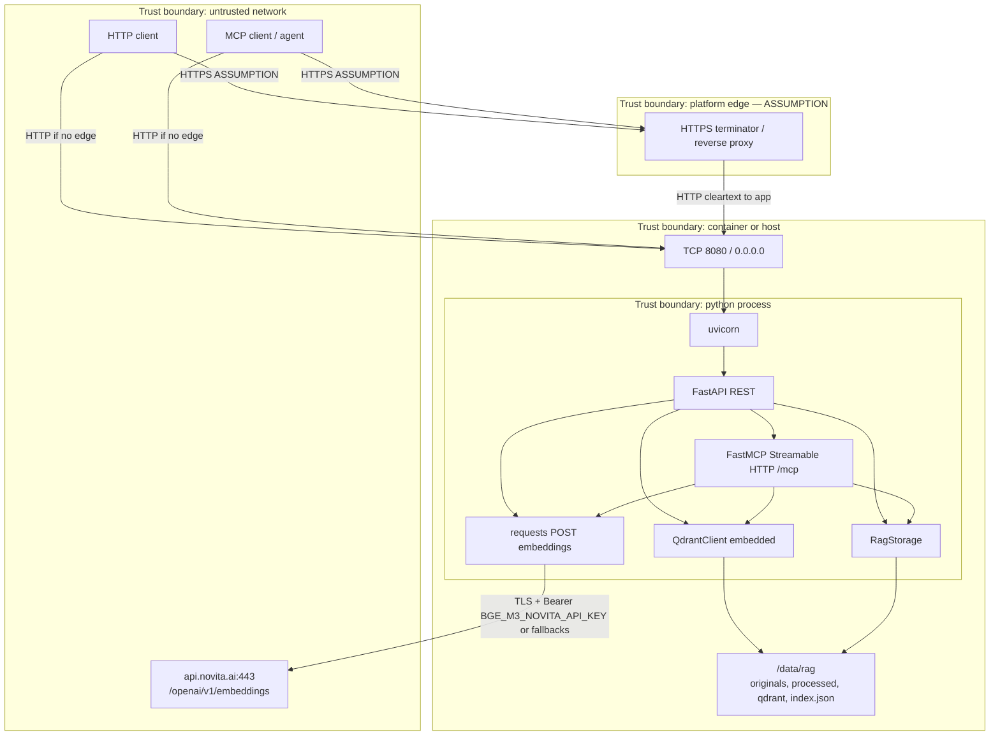
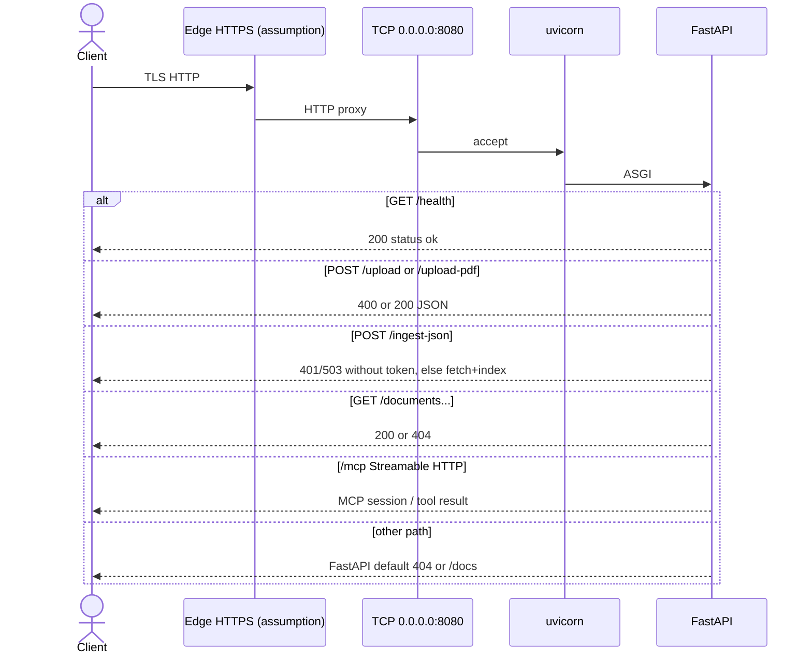
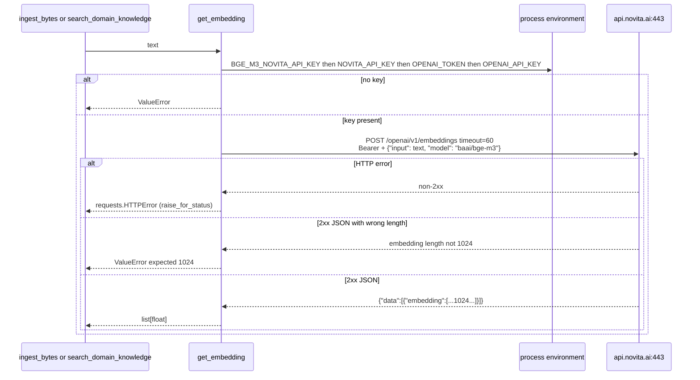

# Connectivity

This document inventories inbound, outbound, and in-process connections for **fastmcp-rag-timer**.

**Sources of truth:** `main.py`, `rag/` (especially `app.py`, `embeddings.py`, `routes.py`, `mcp_tools.py`, `config.py`, `storage.py`, `vectorstore.py`), and `Dockerfile`. There is no reverse-proxy config, TLS cert, compose network, or firewall rules in the repo. Anything about an edge proxy or Railway routing is labeled **Assumption**.

Related: [ARCHITECTURE.md](./ARCHITECTURE.md), [Embedding provider](./embedding-provider.md). Embedding API details are in [Embedding connectivity](#embedding-connectivity).

## Trust boundaries



Trust notes from code:

- Most REST routes and MCP have **no authentication**. Anyone who can reach port 8080 can upload, list documents, read processed text, call `/mcp` tools, and trigger outbound embedding calls.
- `POST /ingest-json` requires inbound `Authorization: Bearer` matching `RAG_API_TOKEN` (503 if that env var is unset).
- FastAPI’s default OpenAPI UI (`/docs`, `/redoc`, `/openapi.json`) is unauthenticated.
- Secrets: outbound embedding key (`BGE_M3_NOVITA_API_KEY`, then `NOVITA_API_KEY`, `OPENAI_TOKEN`, `OPENAI_API_KEY`); inbound `RAG_API_TOKEN` for remote JSON ingest.
- Embedded Qdrant does **not** listen on a network port; it uses `{RAG_DATA_ROOT}/qdrant`.
- The process binds `0.0.0.0`, so it is reachable on every container/host interface.

## Inbound path

```text
Client
  → (optional) HTTPS edge  [Assumption: Railway or other platform TLS]
    → TCP 8080 on the service
      → uvicorn
        → FastAPI
          → REST routes (rag.routes)
          → mount /mcp → FastMCP Streamable HTTP
```



Facts:

- Listen address and port are constants: `HOST = "0.0.0.0"`, `PORT = 8080` in `rag/config.py`; `uvicorn.run(..., host=HOST, port=PORT)`.
- Docker `EXPOSE 8080`.
- No `PORT` env var is read.
- MCP: `FastMCP(..., stateless_http=True, streamable_http_path="/")` mounted at `/mcp`. FastAPI lifespan enters `mcp_app.router.lifespan_context(mcp_app)`.
- No MCP stdio (`mcp.run()` is not called).
- No HTTP/2, gRPC, or unix-socket server is configured in this repo.
- `python-multipart` is installed so FastAPI can parse `UploadFile` bodies.
- There is no CORS middleware (Starlette/FastAPI defaults).
- `GET /health` exists for liveness. There is no Docker `HEALTHCHECK` instruction.

**Assumption:** On Railway, public HTTPS (443) is mapped to the service’s 8080. The repo does not set a Railway port or domain.

## Outbound connections

Runtime network clients in application code:

1. `requests.post` in `rag.embeddings.get_embedding()` — see [Embedding connectivity](#embedding-connectivity).
2. `requests.get` in `rag.remote.fetch_remote_bytes()` — used by `POST /ingest-json` to download public http(s) JSON/GeoJSON (GitHub blob URLs rewritten to `raw.githubusercontent.com`). Private/loopback destinations are rejected.

No code talks to a remote Qdrant URL, PostgreSQL, Redis, SMTP, or webhooks.

Image **build-time** outbound (not runtime):

- Base image `python:3.11-slim-bookworm`
- `ghcr.io/astral-sh/uv:latest`
- Debian apt (`curl`)
- PyPI via `uv pip install --system`

## Internal I/O (not network)

Default root: `RAG_DATA_ROOT` → `/data/rag` (Dockerfile `ENV`; overridable).

| Path | Mechanism | Notes |
| --- | --- | --- |
| `{root}/originals/{doc_id}/<basename>` | `Path.write_bytes` | Raw uploads; basename via `Path(filename).name` |
| `{root}/processed/{doc_id}/meta.json`, `fulltext.txt`, `chunks.json` | UTF-8 files | Written on ingest |
| `{root}/index.json` | JSON catalog; atomic replace via `.json.tmp` | SHA-256 duplicate lookup |
| `{root}/qdrant/` | Embedded Qdrant | No listen port |

README: on Railway, mount a volume at `/data` (the app creates `/data/rag`). Dockerfile does not declare `VOLUME`.

No second container is required for the vector store.

## Transports, ports, and auth points

| Interface | Transport | Port | Auth in repo |
| --- | --- | --- | --- |
| FastAPI REST (most routes) | HTTP/1.1 via uvicorn | **8080/tcp** | **None** |
| `POST /ingest-json` | HTTP/1.1 via uvicorn | 8080 | Bearer `RAG_API_TOKEN` |
| FastAPI OpenAPI UI | HTTP GET | 8080 | **None** |
| MCP Streamable HTTP | HTTP on `/mcp` | 8080 | **None** |
| MCP stdio | — | — | Not started |
| Embedded Qdrant | in-process + disk | no listen port | n/a |
| Novita embeddings | HTTPS | 443 | Bearer `BGE_M3_NOVITA_API_KEY` or fallbacks (outbound) |
| Remote JSON fetch | HTTPS/HTTP | 443/80 | None (public URLs only) |

Auth points that exist: outbound embedding Bearer header; inbound Bearer on `/ingest-json`.

Auth points that do not exist: JWT, mTLS, MCP OAuth, auth on other REST/MCP routes, network policies in-repo.

## Connection inventory

| Source | Destination | Protocol | Port | Auth | Direction |
| --- | --- | --- | --- | --- | --- |
| External HTTP client | uvicorn / FastAPI | HTTP | 8080 | None (except `/ingest-json`) | Inbound |
| External HTTP client | `POST /ingest-json` | HTTP | 8080 | Bearer `RAG_API_TOKEN` | Inbound |
| MCP client | FastMCP at `/mcp` | HTTP (Streamable HTTP) | 8080 | None | Inbound |
| Platform edge (**assumption**) | uvicorn | HTTP (TLS already terminated) | 8080 | None at app | Inbound |
| `get_embedding()` (`requests`) | `https://api.novita.ai/openai/v1/embeddings` | HTTPS | 443 | Bearer `BGE_M3_NOVITA_API_KEY` or fallbacks | Outbound |
| `fetch_remote_bytes()` (`requests`) | caller-supplied public http(s) JSON URL | HTTP/HTTPS | 80/443 | None | Outbound |
| `RagStorage` | `{RAG_DATA_ROOT}` | filesystem | n/a | OS file perms only | Internal read/write |
| `QdrantClient` | `{RAG_DATA_ROOT}/qdrant` | embedded Qdrant / filesystem | n/a | none | Internal read/write |
| Docker build | `ghcr.io`, Debian apt, PyPI | HTTPS | 443 | registry/public | Build-time outbound |
| Operator healthcheck using image `curl` (**assumption**) | `GET /health` on `:8080` | HTTP | 8080 | None | Inbound to self |

## Data that crosses boundaries

| Flow | Data |
| --- | --- |
| Inbound `/upload`, `/upload-pdf` | File bytes; originals stored; extracted text sent to Novita embeddings; vectors + payloads on disk |
| Inbound `/ingest-json` | Remote GeoJSON/JSON bytes fetched by the service; feature attributes indexed (coordinates skipped) |
| Inbound `/upload-media` | Arbitrary bytes; stored under `originals/{uuid}/` only |
| Inbound `GET /documents*` | Catalog metadata and processed fulltext from disk |
| Inbound `/mcp` | Tool arguments and return strings (including document text/chunks) |
| Outbound embedding | Chunk or query **plaintext** plus the API key — see [Embedding connectivity](#embedding-connectivity) |
| Disk Qdrant | Vectors and payloads (`text`, `source`, `doc_id`, `page`, `chunk_index`) |

No encryption-at-rest is configured in this repo. Volume confidentiality is whatever the host provides.

**Assumption:** Production operators will restrict who can reach 8080 (private network, platform auth, or an API gateway). The application does not enforce that.

## Embedding connectivity

This is the only runtime egress to an external API. All of it is in `rag/embeddings.py`, called from `rag.ingest.ingest_bytes` (HTTP upload and MCP `ingest_text`) and `search_domain_knowledge`.

The HTTP API is OpenAI-compatible (`/openai/v1/embeddings`); the host is **Novita**, not `api.openai.com`. There is no chat/completions client.

### APIs, endpoints, and models

| Kind | Used? | Evidence |
| --- | --- | --- |
| Embeddings | **Yes** | `EMBEDDING_URL = "https://api.novita.ai/openai/v1/embeddings"`, `EMBEDDING_MODEL = "baai/bge-m3"`, `EMBEDDING_DIM = 1024` |
| Chat / Completions / Responses | **No** | No chat or LLM client in the repo |
| Azure OpenAI or a configurable base URL | **No** | URL is a module constant; not read from env |

`open_qdrant()` uses `VectorParams(size=EMBEDDING_DIM, ...)`. `get_embedding()` rejects responses whose vector length is not `1024`.

### Base URL and configuration

The embeddings URL is **hardcoded**. There is no `OPENAI_BASE_URL` or Novita base-URL override, and no organization or project header.

```text
POST https://api.novita.ai/openai/v1/embeddings
```

Host `api.novita.ai`, path `/openai/v1/embeddings`, scheme HTTPS.

### Auth and secret handling

`resolve_api_key()` checks, in order:

1. `BGE_M3_NOVITA_API_KEY`
2. `NOVITA_API_KEY`
3. `OPENAI_TOKEN`
4. `OPENAI_API_KEY`

- Sent as `Authorization: Bearer {key}` plus `Content-Type: application/json`.
- If all are missing/empty: `ValueError("Missing Novita credentials. Set BGE_M3_NOVITA_API_KEY.")`.
- Not loaded from a file, Docker secret path, or vault. Application code does not log the key (there is also no application logger).
- Callers may pass `api_key=` into `get_embedding`; production HTTP/MCP paths do not.

**Assumption:** In production the token is a Railway (or other host) environment variable. README’s local example is `export BGE_M3_NOVITA_API_KEY=...`.

### Request / response flow



Request body is a JSON object with string `input` (one text, not a batch array) and `model`. Response handling is `response.json()["data"][0]["embedding"]` after `raise_for_status()`, then a length check. There is no use of `usage` tokens from the response.

TLS certificate verification is the `requests` default (verify on). It is not disabled in code.

**Assumption:** `HTTP_PROXY` / `HTTPS_PROXY` would be honored by `requests` if set in the environment; the app does not configure proxies.

### Egress

- Protocol: HTTPS
- Port: **443** (implicit for `https://`)
- Destination host: `api.novita.ai`
- Frequency: **one POST per chunk** during ingest; **one POST per search query**

### Timeouts, retries, rate limits, error handling

| Concern | Implemented? |
| --- | --- |
| Timeout | **Yes:** `timeout=60` seconds on `requests.post` |
| Retries / backoff | **No** |
| Rate-limit handling (HTTP 429, `Retry-After`) | **No** |
| HTTP status check | **Yes:** `response.raise_for_status()` |
| Dimension check | **Yes:** length must equal `EMBEDDING_DIM` (1024) |
| JSON shape validation | **No** beyond `data[0].embedding` |
| Circuit breaker / cache | **No** |
| Duplicate ingest | **Yes (app-level):** identical SHA-256 skips re-embed |

Error mapping:

- Missing key or unexpected dimension: `ValueError`. HTTP `_ingest_upload` maps **any** `ValueError` to **HTTP 400**.
- Other embedding failures (`requests.HTTPError`, JSON/KeyError): HTTP **500** `"Ingest failed: ..."`.
- MCP `search_domain_knowledge` / `ingest_text`: any exception → tool result string.

### Data sent to Novita (privacy)

Sent on every embedding call:

- The **plaintext** of a chunk (ingest) or the **plaintext query** (search)
- The API key in the Authorization header
- Model name `baai/bge-m3`

Not sent: original PDF/binary (only extracted text chunks), `doc_id`, filenames, Qdrant vectors. Filenames are not in the embedding payload.

Processed fulltext and chunks remain on local disk. Novita also stores whatever their API terms specify for API inputs.

**Assumption:** Operators treating documents as confidential should treat Novita as a third-party processor of extracted text. This repo has no redaction or PII filter.

### Cost considerations

The application does not meter tokens, log `usage`, set budgets, or batch inputs.

- Each chunk is a separate embeddings request (`input` is a string, not a list).
- A large PDF means **N sequential HTTPS calls** (no parallelism in `ingest_bytes`).
- Duplicate files with the same SHA-256 skip embedding (exact-byte duplicates only).
- `/documents/{id}/text`, `list_documents`, and `get_document_chunks` do **not** call Novita.
- Every `search_domain_knowledge` call embeds the query again (no query-embedding cache).
- `/upload-media` does not embed.

**Assumption:** Billing follows Novita’s published pricing for `baai/bge-m3`. Exact rates are not in this repo. Empty-text documents create zero embedding calls.

### Gaps

- No chat/LLM path; this is retrieval infrastructure.
- Base URL and model are not environment-configurable.
- No retries, 429 handling, or batch embeddings.
- Unauthenticated callers can drive embedding spend via `/upload` or MCP `ingest_text` / `search_domain_knowledge`. `/ingest-json` requires `RAG_API_TOKEN` but still triggers embedding spend once authorized.
- Timeout is 60s per request with no overall ingest deadline.
- No recording of token usage for cost attribution.
