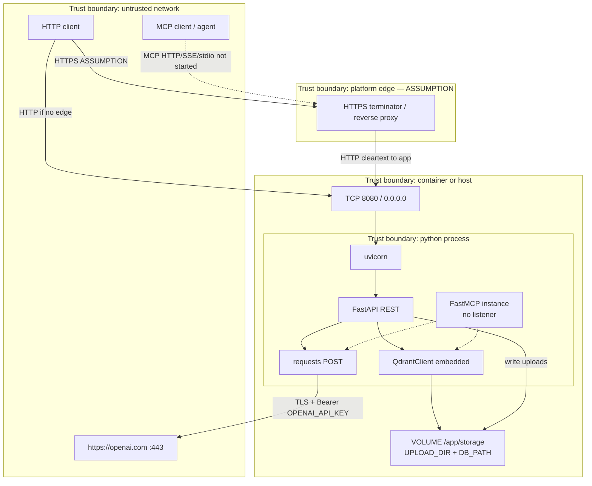
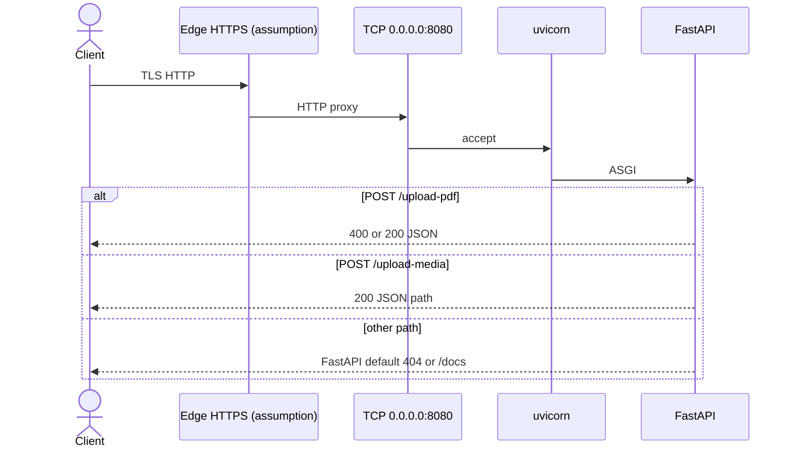

# Connectivity

This document inventories inbound, outbound, and in-process connections for **fastmcp-rag-timer**.

**Sources of truth:** `main.py`, `Dockerfile`. There is no reverse-proxy config, TLS cert, compose network, or firewall rules in the repo. Anything about an edge proxy or Railway routing is labeled **Assumption**.

Related: [ARCHITECTURE.md](./ARCHITECTURE.md).

## Trust boundaries



Dashed MCP lines are registered in code but have **no open socket or stdio MCP server** under `CMD ["python", "main.py"]`.

Trust notes from code:

- REST has **no authentication**. Anyone who can reach port 8080 can upload files and trigger outbound embedding calls.
- FastAPI’s default OpenAPI UI (`/docs`, `/redoc`, `/openapi.json`) is also unauthenticated.
- The only secret is `OPENAI_API_KEY`, used as an outbound Bearer token.
- Embedded Qdrant does **not** listen on a network port; it is a library using `DB_PATH`.
- The process binds `0.0.0.0`, so it is reachable on every container/host interface, not only localhost.

## Inbound path

Implemented path:

```text
Client
  → (optional) HTTPS edge  [Assumption: Railway or other platform TLS]
    → TCP 8080 on the service
      → uvicorn
        → FastAPI routes in main.py
```



Facts:

- Listen address and port are hardcoded: `uvicorn.run(app, host="0.0.0.0", port=8080)`.
- Docker `EXPOSE 8080`.
- No `PORT` env var is read.
- No HTTP/2, gRPC, WebSocket, or unix-socket server is configured.
- `python-multipart` is installed so FastAPI can parse `UploadFile` bodies.
- There is no CORS middleware; browser cross-origin behavior is FastAPI/Starlette default (no CORS headers added in this repo).

Not implemented:

- MCP Streamable HTTP / SSE on any path.
- MCP stdio (`mcp.run()`).
- Healthcheck HTTP endpoint (despite `curl` in the image).

**Assumption:** On Railway, public HTTPS (443) is mapped to the service’s 8080. The repo does not set a Railway port or domain.

## Outbound connections

The only network client in application code is `requests.post` inside `get_embedding()`:

| Field | Value in code |
| --- | --- |
| Method / URL | `POST https://openai.com` |
| Port | Not set; `requests` uses **443** for `https` |
| Headers | `Authorization: Bearer {OPENAI_API_KEY}`, `Content-Type: application/json` |
| Body | `{"input": text, "model": "text-embedding-3-small"}` |
| TLS verify | `requests` default (verify on) — not overridden |
| Timeout | None (`requests.post` default: wait indefinitely) |
| Proxy | None in code (process would honor standard `HTTP(S)_PROXY` if the environment set them — **Assumption**) |

Triggered from:

- `POST /upload-pdf` (once per chunk)
- `search_domain_knowledge` (once per query), if that tool is invoked

No code talks to `api.openai.com`, other LLM providers, a remote Qdrant URL, PostgreSQL, Redis, SMTP, or webhooks.

Image **build-time** outbound (not runtime):

- Base image `python:3.11-slim-bookworm`
- `ghcr.io/astral-sh/uv:latest`
- Debian apt (`curl`)
- PyPI via `uv pip install --system` (unpinned packages)

## Internal I/O (not network)

| Path | Mechanism | Notes |
| --- | --- | --- |
| `UPLOAD_DIR` (default `./storage/files`) | `open` / `shutil.copyfileobj` | Created at import with `os.makedirs(..., exist_ok=True)` |
| `DB_PATH` (default `./storage/qdrant`) | Qdrant embedded storage | Same |
| Docker volume | `VOLUME ["/app/storage"]` | Covers both defaults when `WORKDIR` is `/app` |

No second container is required for the vector store.

## Transports, ports, and auth points

| Interface | Transport | Port | Auth in repo |
| --- | --- | --- | --- |
| FastAPI REST | HTTP/1.1 via uvicorn | **8080/tcp** | **None** |
| FastAPI OpenAPI UI | HTTP GET | 8080 | **None** |
| MCP Streamable HTTP / SSE | — | — | Not started |
| MCP stdio | — | — | Not started |
| Embedded Qdrant | in-process + disk | no listen port | n/a |
| Embedding call | HTTPS | 443 | Bearer `OPENAI_API_KEY` (outbound) |

Auth points that exist: **one**, the outbound OpenAI Bearer header.

Auth points that do not exist: inbound API keys, JWT, mTLS, MCP OAuth, network policies in-repo.

## Connection inventory

| Source | Destination | Protocol | Port | Auth | Direction |
| --- | --- | --- | --- | --- | --- |
| External HTTP client | uvicorn / FastAPI | HTTP | 8080 | None | Inbound |
| Platform edge (**assumption**) | uvicorn / FastAPI | HTTP (TLS already terminated) | 8080 | None at app | Inbound |
| MCP client | FastMCP | MCP over HTTP/SSE/stdio | n/a | n/a | **Not connected** — instance created, no transport |
| `get_embedding()` (`requests`) | `https://openai.com` | HTTPS | 443 | Bearer `OPENAI_API_KEY` | Outbound |
| FastAPI `upload_pdf` / `upload_media` | `UPLOAD_DIR` on local disk | filesystem | n/a | OS file perms only | Internal write |
| `QdrantClient` | `DB_PATH` on local disk | embedded Qdrant / filesystem | n/a | none | Internal read/write |
| Docker build | `ghcr.io`, Debian apt, PyPI | HTTPS | 443 | registry/public | Build-time outbound |
| Operator healthcheck using image `curl` (**assumption**) | `localhost:8080` | HTTP | 8080 | None | Inbound to self; no `/health` route |

## Data that crosses boundaries

| Flow | Data |
| --- | --- |
| Inbound `/upload-pdf` | Raw PDF bytes; stored under the client-supplied filename; text extracted and sent to the embedding URL |
| Inbound `/upload-media` | Arbitrary bytes; stored only |
| Outbound embedding | Chunk or query **plaintext** plus the API key |
| Disk `DB_PATH` | Vectors and payloads (`text`, `source`, `page`) |
| MCP tool return (if ever invoked) | Retrieved `source` + `text` strings |

No encryption-at-rest is configured in this repo. Volume confidentiality is whatever the host provides.

**Assumption:** Production operators will restrict who can reach 8080 (private network, platform auth, or an API gateway). The application does not enforce that.
