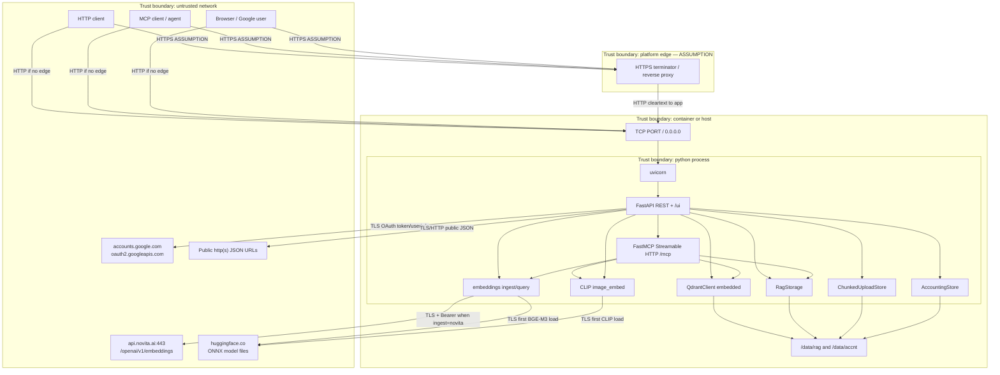
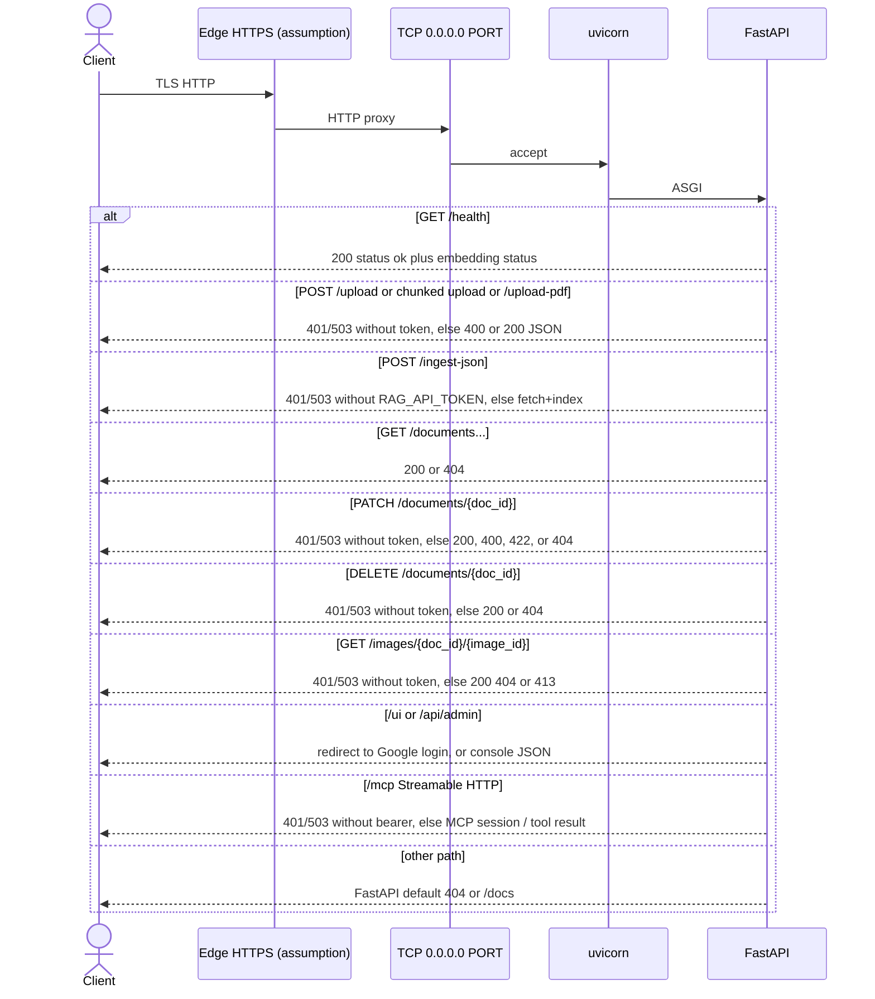
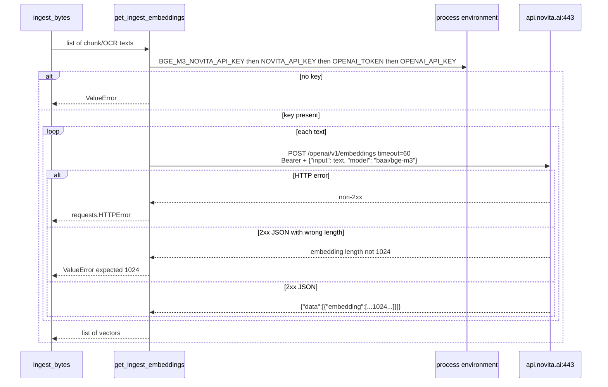

# Connectivity

This document inventories inbound, outbound, and in-process connections for **fastmcp-rag-timer**.

**Sources of truth:** `main.py`, `rag/` (especially `app.py`, `embeddings.py`, `image_embed.py`,
`routes.py`, `admin_routes.py`, `google_oauth.py`, `mcp_tools.py`, `auth.py`, `config.py`,
`storage.py`, `chunked_upload.py`, `vectorstore.py`, `remote.py`), and `Dockerfile`. There is no
reverse-proxy config, TLS cert, compose network, or firewall rules in the repository. Anything about
an edge proxy or Railway routing is labeled **Assumption**.

Related: [ARCHITECTURE.md](./ARCHITECTURE.md), [Embedding provider](./embedding-provider.md). Embedding API details are in [Embedding connectivity](#embedding-connectivity).

## Trust boundaries



Trust notes from code:

- Catalog (`GET /documents*`), `/upload-media`, `/health`, FastAPI OpenAPI UI, and `/auth/status` have **no authentication**.
- `POST /ingest-json` requires inbound `Authorization: Bearer` matching `RAG_API_TOKEN` (503 if that env var is unset).
- `/mcp` requires Bearer `MCP_API_TOKEN` or fallback `RAG_API_TOKEN` (401 invalid, 503 unset). FastMCP also checks `Host` against `MCP_ALLOWED_HOSTS` (421 on mismatch) unless `MCP_DISABLE_DNS_REBINDING_PROTECTION` is set.
- `POST /upload`, chunked upload routes, `POST /upload-pdf`, `GET /images/...`, and `PATCH`/`DELETE /documents/{doc_id}` require that same MCP/RAG bearer **or** a signed-in Google session.
- `/ui/` and `/api/admin/*` require Google OAuth (`GOOGLE_CLIENT_ID` + `GOOGLE_CLIENT_SECRET`) and optional email/domain allow-lists.
- Secrets: outbound Novita embedding key (`BGE_M3_NOVITA_API_KEY`, then `NOVITA_API_KEY`, `OPENAI_TOKEN`, `OPENAI_API_KEY`); inbound `RAG_API_TOKEN` / `MCP_API_TOKEN`; Google client secret; `SESSION_SECRET`; optional Trails Bearer `TRAILS_API_TOKEN` (never logged).
- Embedded Qdrant does **not** listen on a network port; it uses `{RAG_DATA_ROOT}/qdrant`.
- The process binds `0.0.0.0`, so it is reachable on every container/host interface.

## Inbound path

```text
Client
  → (optional) HTTPS edge  [Assumption: Railway or other platform TLS]
    → TCP PORT on the service (default 8080)
      → uvicorn (proxy_headers=True, forwarded_allow_ips=*)
        → FastAPI
          → REST routes (rag.routes)
          → /auth/* (google_oauth)
          → /api/admin (admin_routes, Google session)
          → /ui static console
          → mount /mcp → McpBearerAuth → CompleteResponseOnExit → FastMCP Streamable HTTP
```



Facts:

- Listen host is `HOST = "0.0.0.0"`; port is `PORT = int(os.getenv("PORT", "8080"))` in `rag/config.py`; `uvicorn.run(..., host=HOST, port=PORT, proxy_headers=True, forwarded_allow_ips="*", timeout_graceful_shutdown=15)`.
- Docker `EXPOSE 8080` (image metadata; runtime `PORT` can differ).
- MCP: `FastMCP(..., stateless_http=True, streamable_http_path="/")` mounted at `/mcp`. FastAPI lifespan enters `mcp_app.router.lifespan_context(mcp_app)` and closes Qdrant on exit. `CompleteResponseOnExit` finishes SSE bodies if uvicorn stops mid-stream.
- No MCP stdio (`mcp.run()` is not called).
- No HTTP/2, gRPC, or unix-socket server is configured in this repository.
- `python-multipart` is installed so FastAPI can parse `UploadFile` bodies. Chunked upload uses the raw request body, not multipart.
- There is no CORS middleware (Starlette/FastAPI defaults).
- `GET /health` exists for liveness. There is no Docker `HEALTHCHECK` instruction.

**Assumption:** On Railway, public HTTPS (443) is mapped to the service listen port (`PORT`, often 8080). The repository does not set a Railway port or domain.

## Outbound connections

Runtime network clients in application code:

1. `requests.post` in `rag.embeddings` when **ingest** uses Novita (`EMBEDDING_PROVIDER_INGEST` unset/`novita`) — see [Embedding connectivity](#embedding-connectivity). Search does **not** call Novita.
2. Hugging Face Hub download via FastEmbed on the **first** query embed (always FastEmbed) or FastEmbed ingest, cached under `{RAG_DATA_ROOT}/fastembed` or `FASTEMBED_CACHE_PATH`.
3. Hugging Face Hub download for CLIP vision/text towers when `IMAGE_EMBEDDING_ENABLED=true`, cached under `{RAG_DATA_ROOT}/clip` or `IMAGE_EMBEDDING_CACHE_PATH`.
4. `requests.get` in `rag.remote.fetch_remote_bytes()` — used by `POST /ingest-json` to download public http(s) JSON/GeoJSON (GitHub blob URLs rewritten to `raw.githubusercontent.com`). Private/loopback/link-local/metadata destinations are rejected. Max 5 redirects; size cap `RAG_MAX_REMOTE_JSON_BYTES`.
5. `requests.post` / `requests.get` in `rag.google_oauth` to `oauth2.googleapis.com/token` and `openidconnect.googleapis.com/v1/userinfo` during console sign-in. The browser is redirected to `accounts.google.com/o/oauth2/v2/auth`.

No code talks to a remote Qdrant URL, PostgreSQL, Redis, SMTP, or webhooks.

Image **build-time** outbound (not runtime):

- Base image `python:3.11-slim-bookworm`
- `ghcr.io/astral-sh/uv:latest`
- Debian apt (`curl`, Tesseract `ces` + `eng`)
- PyPI via `uv pip install --system`

The console HTML also references Google Fonts; that fetch is from the **browser**, not the Python process.

## Internal I/O (not network)

Default RAG root: `RAG_DATA_ROOT` → `/data/rag` (Dockerfile `ENV`; overridable).
Default accounting root: `ACCNT_DATA_ROOT` → `/data/accnt`.

| Path | Mechanism | Notes |
| --- | --- | --- |
| `{root}/originals/{doc_id}/<basename>` | `Path.write_bytes` | Raw uploads; basename via `Path(filename).name` |
| `{root}/processed/{doc_id}/meta.json`, `fulltext.txt`, `chunks.json`, `images/` | UTF-8 files + image bytes | Written on ingest |
| `{root}/uploads/{upload_id}/` | chunk parts + `meta.json` | Chunked-upload staging; TTL `RAG_UPLOAD_TTL_SECONDS` |
| `{root}/index.json` | JSON catalog; atomic replace via `.json.tmp` | SHA-256 duplicate lookup |
| `{root}/embedding_backend.json` | JSON marker | Named-vector schema version 2 |
| `{root}/qdrant/` | Embedded Qdrant | No listen port |
| `{root}/fastembed/`, `{root}/clip/` | ONNX caches | Unless cache path env overrides |
| `{ACCNT_DATA_ROOT}/YYYY-MM-DD.json` and `events/` | JSON / JSONL | Accounting |

README: on Railway, mount a volume at `/data` (the app creates `/data/rag` and `/data/accnt`). Dockerfile does not declare `VOLUME`.

No second container is required for the vector store.

## Transports, ports, and auth points

| Interface | Transport | Port | Auth in repository |
| --- | --- | --- | --- |
| FastAPI REST (catalog, fulltext, `/upload-media`, `/health`, OpenAPI) | HTTP/1.1 via uvicorn | **`PORT` (default 8080)/tcp** | **None** |
| `POST /upload`, chunked upload, `POST /upload-pdf`, `GET /images/...`, `PATCH`/`DELETE /documents/{doc_id}` | HTTP/1.1 via uvicorn | `PORT` | Bearer `MCP_API_TOKEN`/`RAG_API_TOKEN` or Google session |
| `POST /ingest-json` | HTTP/1.1 via uvicorn | `PORT` | Bearer `RAG_API_TOKEN` |
| `/ui/` and `/api/admin/*` | HTTP | `PORT` | Google session |
| `/auth/*` | HTTP | `PORT` | Public login/status; `/auth/me` requires session |
| MCP Streamable HTTP | HTTP on `/mcp` | `PORT` | Bearer `MCP_API_TOKEN`/`RAG_API_TOKEN`; Host allow-list |
| MCP stdio | — | — | Not started |
| Embedded Qdrant | in-process + disk | no listen port | n/a |
| Novita embeddings | HTTPS | 443 | Bearer `BGE_M3_NOVITA_API_KEY` or fallbacks (outbound; **ingest only**) |
| FastEmbed / CLIP model download | HTTPS | 443 | none (Hugging Face Hub, first load) |
| Google OAuth | HTTPS | 443 | OAuth client id/secret |
| Remote JSON fetch | HTTPS/HTTP | 443/80 | None (public URLs only; SSRF guards) |

Auth points that exist: outbound Novita Bearer; inbound Bearer on `/ingest-json`; inbound Bearer or Google session on embedding REST; inbound Bearer on `/mcp`; Google OAuth on the console.

Auth points that do not exist: JWT (other than Google session cookie), mTLS, MCP OAuth, auth on catalog/fulltext/`/upload-media`, network policies in the repository.

## Connection inventory

| Source | Destination | Protocol | Port | Auth | Direction |
| --- | --- | --- | --- | --- | --- |
| External HTTP client | uvicorn / FastAPI | HTTP | `PORT` | None on catalog/media/health | Inbound |
| External HTTP client | `POST /ingest-json` | HTTP | `PORT` | Bearer `RAG_API_TOKEN` | Inbound |
| External HTTP client | upload / delete / images | HTTP | `PORT` | Bearer or Google session | Inbound |
| MCP client | FastMCP at `/mcp` | HTTP (Streamable HTTP) | `PORT` | Bearer MCP/RAG token | Inbound |
| Browser | `/ui`, `/auth`, `/api/admin` | HTTP | `PORT` | Google OAuth session | Inbound |
| Platform edge (**assumption**) | uvicorn | HTTP (TLS already terminated) | `PORT` | None at app | Inbound |
| `get_ingest_embeddings()` (`requests`) | `https://api.novita.ai/openai/v1/embeddings` | HTTPS | 443 | Bearer `BGE_M3_NOVITA_API_KEY` or fallbacks | Outbound (Novita ingest) |
| FastEmbed `TextEmbedding` | Hugging Face `BAAI/bge-m3` ONNX | HTTPS | 443 | none | Outbound on first query/FastEmbed ingest |
| CLIP `ImageEmbedding` / text tower | Hugging Face CLIP ViT-B/32 ONNX | HTTPS | 443 | none | Outbound on first visual embed |
| `google_oauth` (`requests`) | Google token + userinfo | HTTPS | 443 | OAuth client secret | Outbound |
| `fetch_remote_bytes()` (`requests`) | caller-supplied public http(s) JSON URL | HTTP/HTTPS | 80/443 | None | Outbound |
| `RagStorage` / uploads / accounting | `{RAG_DATA_ROOT}` / `{ACCNT_DATA_ROOT}` | filesystem | n/a | OS file perms only | Internal read/write |
| `QdrantClient` | `{RAG_DATA_ROOT}/qdrant` | embedded Qdrant / filesystem | n/a | none | Internal read/write |
| Docker build | `ghcr.io`, Debian apt, PyPI | HTTPS | 443 | registry/public | Build-time outbound |
| Operator healthcheck using image `curl` (**assumption**) | `GET /health` on listen port | HTTP | `PORT` | None | Inbound to self |

## Data that crosses boundaries

| Flow | Data |
| --- | --- |
| Inbound `/upload`, chunked complete, `/upload-pdf` | File bytes; originals stored; extracted text embedded (Novita and/or FastEmbed); vectors + payloads on disk |
| Inbound `/ingest-json` | Remote GeoJSON/JSON bytes fetched by the service; feature attributes indexed (coordinates skipped) |
| Inbound `/upload-media` | Arbitrary bytes; stored under `originals/{uuid}/` only |
| Inbound `GET /documents*` | Catalog metadata and processed fulltext from disk (unauthenticated) |
| Inbound `PATCH /documents/{doc_id}` | Authenticated in-place catalog + Qdrant payload metadata update (no re-embed) |
| Inbound `DELETE /documents/{doc_id}` | Authenticated removal of originals, processed files, catalog row, and Qdrant points |
| Inbound `/mcp` | Tool arguments and return strings (including document text/chunks); optional inline image bytes up to 5 MiB |
| Inbound `/ui` and `/api/admin` | Google profile in session; volume listings, log buffer, accounting rollups |
| Outbound Novita embedding | Chunk **plaintext** plus the API key — ingest only; see [Embedding connectivity](#embedding-connectivity) |
| Outbound TrailsAssemblage | Locality-link JSON to `TRAILS_API_URL` (`POST /locality-links`, `PATCH /locality-links/{id}/verify`) with Bearer `TRAILS_API_TOKEN` when both env vars are set. Token is never logged. Failures retry then persist to `{RAG_DATA_ROOT}/trails_outbox.json`. |
| Outbound FastEmbed/CLIP | Model weights from Hugging Face; query plaintext stays local after download |
| Disk Qdrant | Named vectors and payloads (`source_type`, `text`/`content_summary`, `source`/`parent_document`, `doc_id`, `page_number`, `chunk_index`, `image_id`, `file_path`, `sha256`) |

No encryption-at-rest is configured in this repository. Volume confidentiality is whatever the host provides.

**Assumption:** Production operators will restrict who can reach the listen port (private network, platform auth, or an API gateway) in addition to the app’s bearer/Google checks. Unauthenticated catalog/fulltext remain reachable to anyone who can hit the port.

## Embedding connectivity

Ingest embeddings are Novita by default (`EMBEDDING_PROVIDER` / `EMBEDDING_PROVIDER_INGEST`). All of
it is in `rag/embeddings.py`, called from `rag.ingest.ingest_bytes` (HTTP upload, chunked complete,
`/ingest-json`, MCP `ingest_text`). Search (`search_domain_knowledge` and the hybrid text leg of
`search_images`) calls `get_query_embedding`, which is **local FastEmbed only** — no Novita tokens on
query.

Set `EMBEDDING_PROVIDER_INGEST=fastembed` to skip Novita on ingest as well. The first FastEmbed call downloads ONNX weights from Hugging Face (~2.3GB). Query always needs that download even when ingest stays on Novita.

The Novita HTTP API is OpenAI-compatible (`/openai/v1/embeddings`); the host is **Novita**, not `api.openai.com`. There is no chat/completions client.

### APIs, endpoints, and models

| Kind | Used? | Evidence |
| --- | --- | --- |
| Embeddings (ingest) | **Yes** | Novita: `NOVITA_EMBEDDING_URL`, model `baai/bge-m3`, dim 1024, **or** FastEmbed `BAAI/bge-m3` ONNX dim 1024. Selected by `EMBEDDING_PROVIDER_INGEST`. |
| Embeddings (query) | **Yes, local only** | FastEmbed `BAAI/bge-m3` 1024. Startup refuses a Novita query provider. |
| Image embeddings | **Optional** | CLIP `Qdrant/clip-ViT-B-32-vision` / `-text`, dim 512, when `IMAGE_EMBEDDING_ENABLED=true`. |
| Chat / Completions / Responses | **No** | No chat or LLM client in the repository |
| Azure OpenAI or a configurable base URL | **No** | Novita URL is a module constant; provider is selected by env |

`open_qdrant()` creates named vectors `text_vector` (1024) and `image_vector` (512). Ingest/query helpers reject vectors whose length is not the active dimension.

### Base URL and configuration

The Novita embeddings URL is **hardcoded**. There is no `OPENAI_BASE_URL` or Novita base-URL override, and no organization or project header.

```text
POST https://api.novita.ai/openai/v1/embeddings
```

Host `api.novita.ai`, path `/openai/v1/embeddings`, scheme HTTPS. Used only when ingest provider is Novita.

### Auth and secret handling

`resolve_api_key()` checks, in order:

1. `BGE_M3_NOVITA_API_KEY`
2. `NOVITA_API_KEY`
3. `OPENAI_TOKEN`
4. `OPENAI_API_KEY`

- Sent as `Authorization: Bearer {key}` plus `Content-Type: application/json`.
- If all are missing/empty on a Novita ingest call: `ValueError("Missing Novita credentials. Set BGE_M3_NOVITA_API_KEY.")`.
- Not loaded from a file, Docker secret path, or vault. Application code does not log the key.
- Callers may pass `api_key=` into ingest helpers; production HTTP/MCP paths do not.
- FastEmbed and CLIP paths send no API key.

**Assumption:** In production the Novita token is a Railway (or other host) environment variable. README’s local example is `export BGE_M3_NOVITA_API_KEY=...` plus `EMBEDDING_PROVIDER_QUERY=fastembed`.

### Request / response flow (Novita ingest)



Request body is a JSON object with string `input` (one text, not a batch array) and `model`. Response handling is `response.json()["data"][0]["embedding"]` after `raise_for_status()`, then a length check. `usage.prompt_tokens` / `usage.total_tokens` are recorded in accounting when present.

TLS certificate verification is the `requests` default (verify on). It is not disabled in code.

**Assumption:** `HTTP_PROXY` / `HTTPS_PROXY` would be honored by `requests` if set in the environment; the app does not configure proxies.

Query path (not shown): `get_query_embedding` → FastEmbed ONNX, no HTTPS to Novita.

### Egress

- Novita protocol: HTTPS port **443**, host `api.novita.ai`
- Frequency on Novita ingest: **one POST per text** (chunk or OCR summary); FastEmbed ingest batches locally
- Frequency on search: **zero Novita calls**; one local FastEmbed encode per query (plus CLIP if `search_images`)

### Timeouts, retries, rate limits, error handling

| Concern | Implemented? |
| --- | --- |
| Timeout | **Yes:** `timeout=60` seconds on Novita `requests.post`; Google OAuth uses 30s; remote JSON uses `RAG_REMOTE_FETCH_TIMEOUT` (default 120) |
| Retries / backoff | **No** |
| Rate-limit handling (HTTP 429, `Retry-After`) | **No** |
| HTTP status check | **Yes:** `response.raise_for_status()` |
| Dimension check | **Yes:** length must equal the provider dimension (1024 text / 512 CLIP) |
| JSON shape validation | **No** beyond `data[0].embedding` |
| Circuit breaker / cache | **No** (ONNX models stay loaded in-process after first use) |
| Duplicate ingest | **Yes (app-level):** identical SHA-256 skips re-embed |

Error mapping:

- Missing key or unexpected dimension: `ValueError`. HTTP `_ingest_upload` maps **any** `ValueError` to **HTTP 400**.
- Other embedding failures (`requests.HTTPError`, JSON/KeyError): HTTP **500** `"Ingest failed: ..."`.
- MCP `search_domain_knowledge` / `ingest_text` / `search_images`: any exception → tool result string.

### Data sent to Novita (privacy)

Sent on every **ingest** Novita call:

- The **plaintext** of a chunk or OCR summary
- The API key in the Authorization header
- Model name `baai/bge-m3`

Not sent: original PDF/binary (only extracted text), `doc_id`, filenames, Qdrant vectors, or **search queries** (queries stay local in FastEmbed). Filenames are not in the embedding JSON body.

Processed fulltext and chunks remain on local disk. Novita also stores whatever their API terms specify for API inputs.

**Assumption:** Operators treating documents as confidential should treat Novita as a third-party processor of extracted ingest text. This repository has no redaction or PII filter.

### Cost considerations

The application meters embedding and communications usage into durable **UTC per-day** files under `ACCNT_DATA_ROOT` (default `/data/accnt`):

- `YYYY-MM-DD.json` — daily rollups (embedding calls/tokens/chars by source, MCP by tool, HTTP routes, outbound)
- `events/YYYY-MM-DD.jsonl` — append-only per-call audit lines

`_get_novita_embedding()` records Novita `usage.prompt_tokens` / `usage.total_tokens` when the API returns them; otherwise it records `input_chars` and marks the call as not API-tokenized (`tokens_estimated`). FastEmbed records `input_chars` with `count_outbound=false`.
Sources are attributed via context (`ingest_http`, `ingest_mcp`, `search_mcp`).
Each call is also appended to the day's JSONL event log.
The Google-gated Accounts console tab reads `/api/admin/accounts` and `/api/admin/accounts/{date}?include_events=true&event_kind=embedding` to show per-source rollups and per-call prompt/total tokens.

There are still **no budgets**, spend caps, or dollar conversion.

- Each Novita ingest text is a separate embeddings request (`input` is a string, not a list).
- A large PDF means **N sequential HTTPS calls** when ingest is Novita (no parallelism in `ingest_bytes`). FastEmbed ingest batches those strings locally.
- Duplicate files with the same SHA-256 skip embedding (exact-byte duplicates only).
- `/documents/{id}/text`, `PATCH /documents/{id}`, `list_documents`, `get_document_chunks`, and `update_document` do **not** embed.
- Every `search_domain_knowledge` call embeds the query locally (no query-embedding cache; no Novita query spend).
- `/upload-media` does not embed.

**Assumption:** Billing follows Novita’s published pricing for `baai/bge-m3` on ingest. Exact rates are not in this repository. Empty-text documents create zero embedding calls.

### Gaps

- No chat/LLM path; this is retrieval infrastructure.
- Novita base URL and model are not environment-configurable.
- No retries, 429 handling, or batched Novita embeddings.
- Unauthenticated callers cannot drive Novita spend via `/upload` or MCP (those require a token or Google session) but **can** read catalog/fulltext and write `/upload-media`. `/ingest-json` requires `RAG_API_TOKEN` and still triggers ingest embedding spend once authorized.
- Novita timeout is 60s per request with no overall ingest deadline.
- No per-MCP-client identity (stateless HTTP); accounting is process-wide totals only.
- `search_mcp` accounting source is recorded for local FastEmbed queries even though they do not bill Novita.
