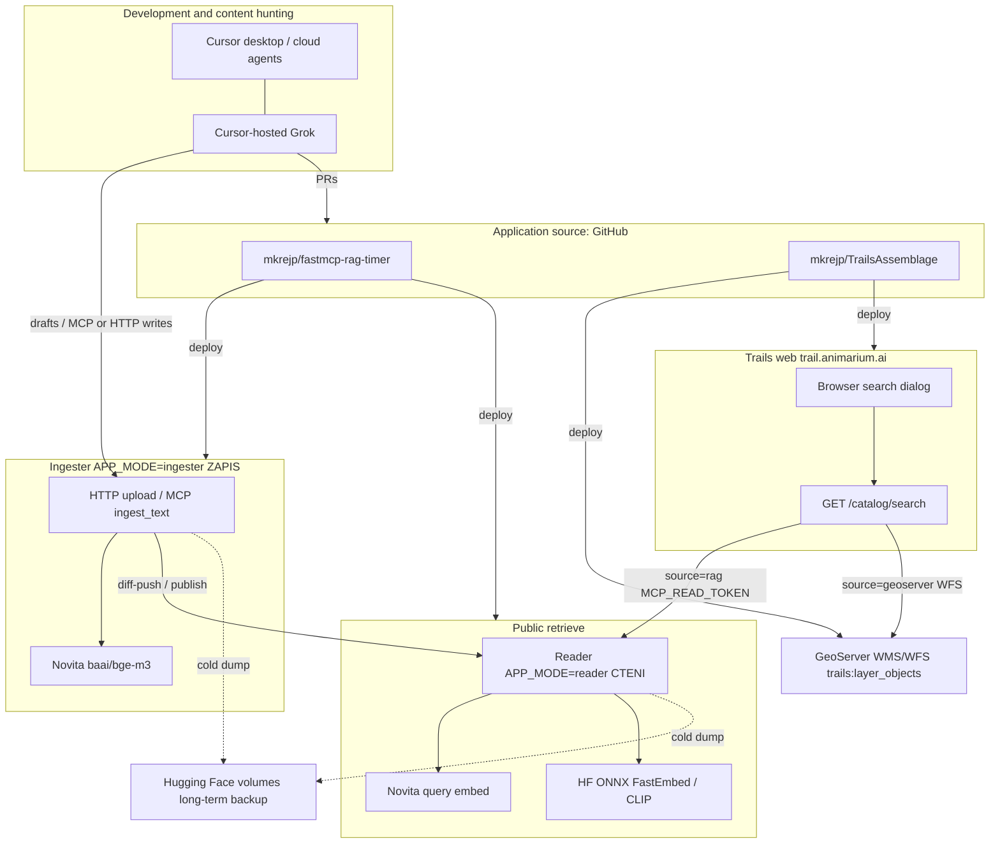

# ADR: Inference roles (Novita + Hugging Face vs Cursor Grok)

- **Status:** Accepted (Marek, 2026-11-24)
- **Date:** 2026-11-24
- **Deciders:** Marek
- **Scope of this PR:** prepaid Novita MCP `chat_helper` (rerank on, chat off
  by default), this ADR, and pointers from README / ARCHITECTURE /
  CONNECTIVITY / embedding-provider / AI_AGENTS. No Railway env mutation, no
  secrets.
- **Related:** [ARCHITECTURE.md](../ARCHITECTURE.md),
  [CONNECTIVITY.md](../CONNECTIVITY.md),
  [embedding-provider.md](../embedding-provider.md),
  [AI_AGENTS.md](../AI_AGENTS.md).
  Trails catalogue search lives in `mkrejp/TrailsAssemblage`
  (`docs/catalog-search.md`). GeoServer lives in that repository under `geoserver/`.

## 1. Decision

| Work | Who / what | Not |
| --- | --- | --- |
| **Reader (ČTENÍ) search embeddings** | Novita `baai/bge-m3` (default) or Hugging Face ONNX FastEmbed `BAAI/bge-m3` | xAI, Vercel AI Gateway embeddings, Cursor Grok |
| **Reader refined ranking** | Prepaid Novita `baai/bge-reranker-v2-m3` (`MCP chat_helper`) | Novita Coding Plan, dedicated GPU, Gateway embeddings |
| **Reader helper phrasing** | Optional Gateway `vmc/cheap` (Novita DeepSeek flash BYOK), **off by default** | xAI, Grok, Coding Plan, Vercel provider fallback |
| **Ingester (ZÁPIS) text embeddings** | Same Novita / FastEmbed BGE-M3 1024-dim family | A chat model writing vectors |
| **Optional visual search** | Hugging Face CLIP `Qdrant/clip-ViT-B-32-*` when `IMAGE_EMBEDDING_ENABLED=true` | Grok vision as the image index |
| **Trails web catalogue search** | Browser → Trails `GET /catalog/search` (**signed-in** session or Bearer). **RAG** typeahead = reader MCP `search_domain_knowledge`. **RAG Ask/chat** (later) = same Trails proxy → reader MCP `chat_helper` for **logged-in users only**. **GeoServer** = WFS `ILIKE` | Anonymous chat; browser calling RAG/GeoServer; Grok in the dialog; pointing Trails at the ingester |
| **GeoServer** | WMS/WFS geometry and attribute filter (PostGIS). No embeddings | xAI, Novita chat, Hugging Face inference chat |
| **Development, content hunting, loading into the ingester** | **Cursor agents + Cursor-hosted Grok** (Cursor plan, not an xAI BYOK key on Vercel) opening PRs on GitHub and calling `APP_MODE=ingester` HTTP/MCP writes | Grok as the public reader or as GeoServer |
| **Application source of truth** | **GitHub repositories** (this repository, `mkrejp/TrailsAssemblage`, related Marek GitHub apps) | Vercel project files, Railway-only edits, Hugging Face Spaces as the app origin |
| **Long-term backup** | **Hugging Face volumes** (cold dumps of RAG / PostGIS / media; HFHosts + ControlApps) | Live origin, catalogue search backend, or a substitute for GitHub |

Indexed text is still embedded with Novita or local Hugging Face ONNX (1024-dim
BGE-M3). A **bounded** reader exception is MCP `chat_helper`: retrieve, then
prepaid Novita rerank, then optional `vmc/cheap` phrasing over those hits only.
Chat is **off by default** and daily-capped. Generation for hunting and coding
still happens **outside** this process (Cursor), against **GitHub**.

## 2. Why

- Vercel AI Gateway has **no** `baai/bge-m3`. Query and ingest vectors must stay
  on Novita HTTP (`https://api.novita.ai/openai/v1/embeddings`) or FastEmbed ONNX
  downloaded from Hugging Face. Mixing a chat model into the 1024-dim collection
  would break recall.
- Trails already splits catalogue search into **GeoServer WFS** (map objects) and
  **RAG reader MCP** (facts). GeoServer is geometry; it must not grow an LLM
  dependency. The web app never calls rag-timer or GeoServer from the browser
  (`docs/catalog-search.md` in TrailsAssemblage).
- Cursor already includes Grok on the plan. An xAI key on Vercel is not required
  for agents that hunt sources and POST to the **ingester**. Fail-closed Gateway
  (no Vercel provider fallback) made `vmc/grok` a 403 without BYOK; that alias is
  **archived** and Gateway **denies** `spacexai/grok-4.7` / `vmc/grok`.
- **GitHub is the application repository.** Cursor/Grok agents change apps by
  branch + PR on GitHub. Railway and optional Vercel Gateway are runtimes, not
  a second copy of the app.
- **Hugging Face volumes are the long-term backup target.** Hub ONNX downloads
  (BGE-M3, CLIP) are a different Hugging Face use. Spaces must not become the
  application origin. sftpgo remains a desktop / short-horizon sink
  ([media-server ADR](./media-server-provenance.md) §3.7).

## 3. Topology

**Never:** Trails or GeoServer → xAI / `vmc/grok`. **Never:** reader → Grok.
**Never:** catalogue search pointed at ingester `rag-timer-00001`.
**Never:** treat Vercel, Railway dashboard edits, or Hugging Face Spaces as the
application repository.
**Never:** serve Trails or GeoServer from a Hugging Face volume (backup only).

## 4. Cursor / Grok on the ingester

Allowed:

- Code work as **GitHub PRs** on this repository and `mkrejp/TrailsAssemblage` (and
  any other Marek GitHub application repository). That is the application repository.
- Hunting public-domain facts, captions, GPS candidates.
- Loading accepted payloads into **`APP_MODE=ingester`** (`POST /upload`,
  chunked upload, `POST /ingest-json`, MCP `ingest_text` / metadata tools)
  with Bearer `MCP_API_TOKEN` / `RAG_API_TOKEN` or a Google console session.

Operational constraints that still apply ([AI_AGENTS.md](./AI_AGENTS.md)):

- The named production writer remains **RAGloader**. Cursor/Grok agents load
  through the **ingester APIs**, not by writing the reader volume directly.
- Corrections = new document plus supersede link. Deletes only with Marek’s OK.
- No secrets in git or the noticeboard.
- Reader stays write-blocked (`APP_MODE=reader`).

## 5. Novita and Hugging Face (reader + search)

| Path | Backend | Model | Dim |
| --- | --- | --- | --- |
| Ingest / OCR index | `EMBEDDING_PROVIDER_INGEST` (`novita` default) | Novita `baai/bge-m3` or FastEmbed `BAAI/bge-m3` | 1024 |
| Query (`search_domain_knowledge`, hybrid text of `search_images`) | `EMBEDDING_PROVIDER_QUERY` (reader default **novita**) | same family | 1024 |
| Optional `image_vector` | local ONNX from Hugging Face Hub | `Qdrant/clip-ViT-B-32-vision` / `-text` | 512 |

Low-RAM reader: `APP_MODE=reader`, `EMBEDDING_PROVIDER_QUERY=novita`,
`IMAGE_EMBEDDING_ENABLED=false`. Hugging Face is then only a **build/cache**
source if a host opts into FastEmbed or CLIP — not a chat API.

**Novita billing is prepaid Model API credits** (manual Stripe top-up over $10).
Do **not** buy the monthly Novita Coding Plan: it is a coding-IDE quota, does
not include BGE-M3 or the reranker, and conflicts with the no-monthly-sub
preference.

| Prepaid Model API | Role | Typical list price |
| --- | --- | --- |
| `baai/bge-m3` | ingest + query embeddings | $0.01 / Mt |
| `baai/bge-reranker-v2-m3` | helper refined ranking | $0.01 / Mt |
| `deepseek/deepseek-v4.1-flash` via `vmc/cheap` | optional helper phrasing | $0.3 / $1.2 / Mt + Gateway BYOK fee |

Vercel `vmc/cheap` is **not** the Trails typeahead path and **not** GeoServer.
Trails `source=rag` stays MCP `search_domain_knowledge` while typing. Helper
phrasing is opt-in (`CHAT_HELPER_CHAT=1` plus `use_chat=true`) and must pin
`providerOptions.gateway.only = ["novita"]`. Gateway team budgets currently
**exclude BYOK**, so daily in-process caps
(`CHAT_HELPER_DAILY_RERANK_CALLS`, `CHAT_HELPER_DAILY_CHAT_CALLS`) are the
spend brake. Prefer a dedicated reader Gateway key with `includeByokInQuota`
if Marek enables chat.

## 6. Trails web and GeoServer

Facts from Trails `docs/catalog-search.md` and `geoserver/README.md` (not this repository):

| Surface | Search mechanism | Inference |
| --- | --- | --- |
| Vite app `https://trail.animarium.ai` catalogue dialog | Trails `GET /catalog/search` | None in the browser |
| `source=rag` (typeahead) | MCP `search_domain_knowledge` `format=json` on `{RAG_READER_URL}/mcp/` with `MCP_READ_TOKEN` | Reader Novita (or FastEmbed). Trails already requires a signed-in session |
| `source=rag` Ask / chat | Same Trails origin, **logged-in only**, explicit Ask/Enter → MCP `chat_helper` (`use_chat` only when `CHAT_HELPER_CHAT=1`) | Anonymous users; debounce typeahead; GeoServer WFS |
| `source=geoserver` | WFS 2.0 `GetFeature` `trails:layer_objects` CQL `ILIKE` | None (PostGIS text) |
| GeoServer WMS/WMTS | PNG tiles of catalog/locality layers | None |

If RAG MCP is unset, Trails degrades to unauthenticated `GET /documents` filename
filter — still not Grok.

## 7. GitHub is the application repository

| GitHub repository | Application |
| --- | --- |
| `mkrejp/fastmcp-rag-timer` (this repository) | RAG reader + ingester (FastAPI / FastMCP / Qdrant) |
| `mkrejp/TrailsAssemblage` | Trails web app, catalogue search, GeoServer image, PostGIS catalog importers |

Cursor agents develop by cloning these remotes, branching, and opening pull
requests. Runtime hosts (Railway for RAG / Trails / GeoServer; optional Vercel
AI Gateway for `vmc/cheap`) **deploy from GitHub**. They are not a second copy
of the application.

Operator-box noticeboard paths and Hugging Face ONNX caches are **not**
application repositories.

## 8. Hugging Face volumes (long-term backup)

| Hugging Face use | Role |
| --- | --- |
| **Volumes** (HF storage / dataset dumps) | **Long-term backup** of RAG data, PostGIS, and (later) media. Cold. Not an HTTP origin. |
| Hub ONNX (`BAAI/bge-m3`, CLIP ViT-B/32) | Runtime embedding weights for FastEmbed / visual search |
| Spaces / Inference chat | **Not** the app, **not** Trails/GeoServer search |

Backup jobs stay with **HFHosts** and **ControlApps** (operator box; not implemented in this repository). Restore reads volumes back onto Railway; it does not point `RAG_READER_URL` or `GEOSERVER_URL` at Hugging Face.

sftpgo + `sftp-mirror-geo-server` stay desktop / nightly short-horizon copies. They do not replace Hugging Face volumes as the long-term target.

## 9. Vercel AI Gateway (team `animarium-ai`)

Hobby credits + Novita BYOK remain for optional helper phrasing (`vmc/cheap`).
**No xAI in this solution:**

- `vmc/grok` **archived**
- Deny rules on `spacexai/grok-4.7` and `vmc/grok`
- Fallback to Vercel provider keys **off** (development fail-closed)

Do not add an xAI BYOK key unless Marek reopens this ADR.

## 10. Consequences

- Reader and Trails RAG search fail if Novita credentials are missing and query
  is `novita` (no silent Grok fallback).
- GeoServer cold-start still affects only the WFS source; the RAG source can
  still return.
- Cursor Grok spend stays on the Cursor plan, not Vercel Gateway credits.
- Hugging Face volumes are cold; a restore is an operator action (HFHosts /
  ControlApps), not automatic failover for Trails or GeoServer.
- Changing this split (Grok on the reader, xAI BYOK for `vmc/grok`, moving
  application source off GitHub, or using HF volumes as a live origin) needs a
  new decision in this file.
